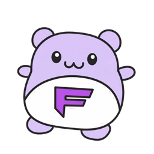
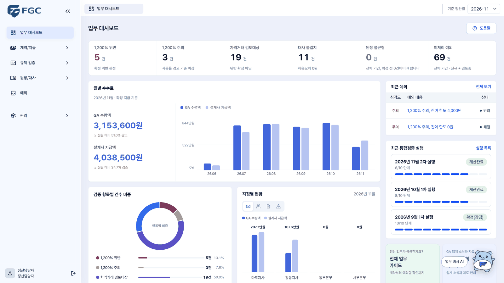
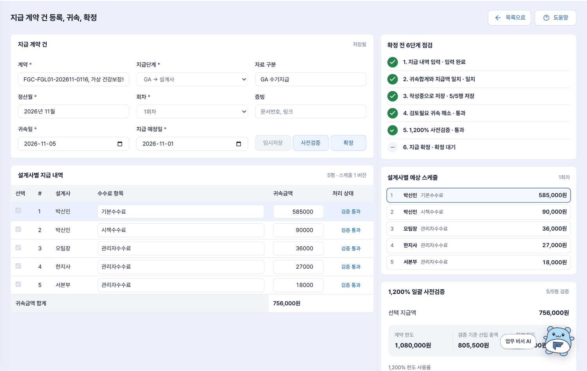
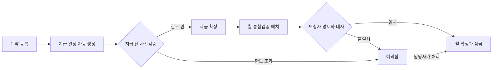
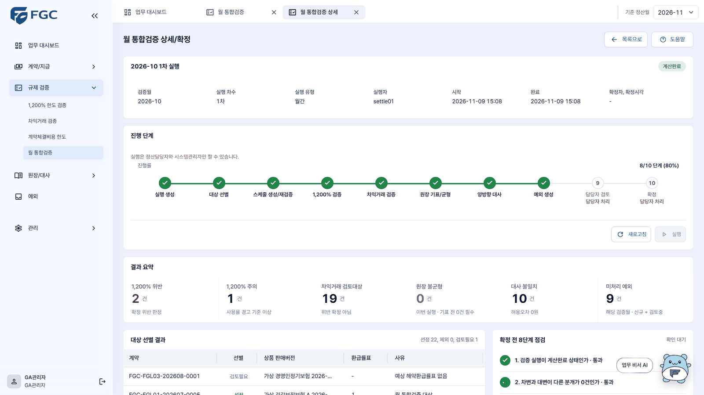
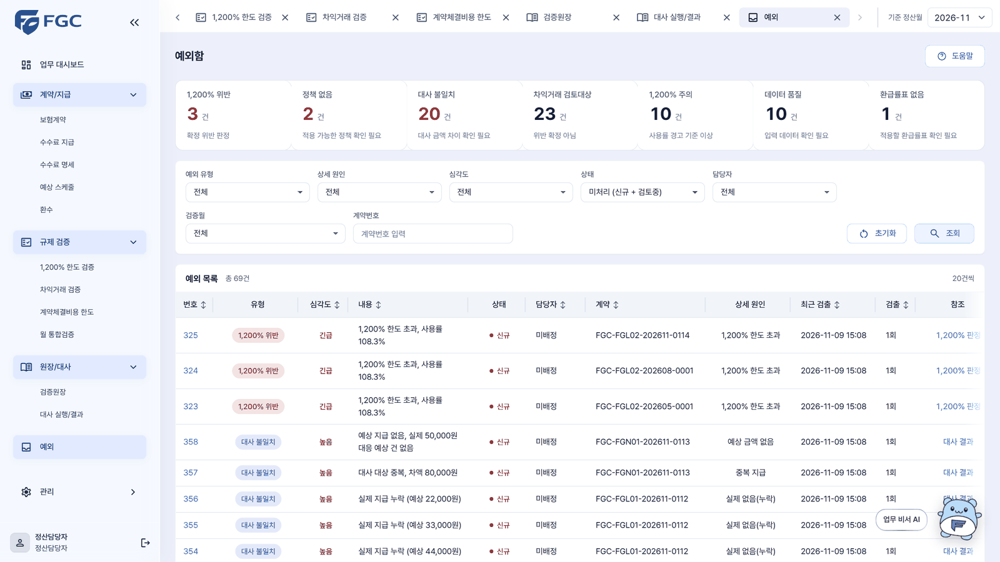
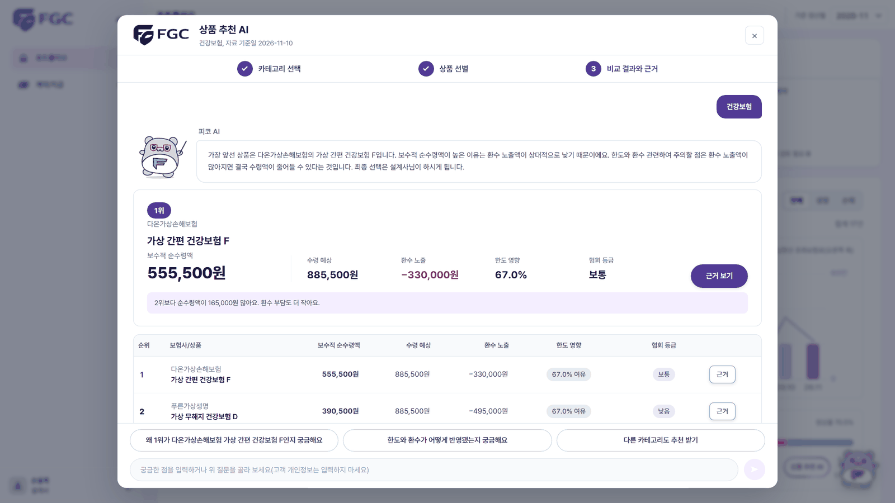
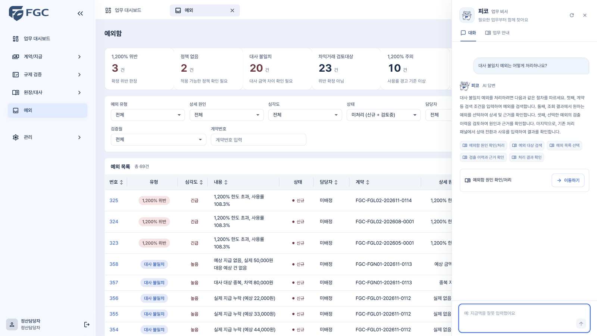

<div align="center">
  
  <h1>FGC (Fee GA Chu)</h1>
  <p><b>보험 수수료, 나가기 전에 검산합니다.</b></p>
  <p>
    보험 판매 회사가 설계사에게 수수료를 주기 전에<br>
    규제 한도를 넘는지, 보험사가 보낸 명세와 맞는지 먼저 확인하는 정산 검증 플랫폼
  </p>
</div>

<p align="center">
  
</p>

<table align="center">
  <tr>
    <td align="center"><b>지급 전 6단계 점검</b><br>한도를 넘는 지급은 확정되지 않습니다</td>
    <td align="center"><b>자동 테스트 3,596건</b><br>모든 변경은 테스트와 리뷰를 통과해야 합쳐집니다</td>
    <td align="center"><b>규제 조문 24개, 요구사항 178건</b><br>조문에서 화면, API, 테스트까지 번호로 이어집니다</td>
  </tr>
</table>

<p align="center"><sub>테스트 건수는 2026-11-08 CI 실행 기준이고, 화면의 회사와 사람과 금액은 모두 가상입니다.</sub></p>

## 수수료 한 건이 겪는 일

보험을 한 건 팔면 그 뒤에서 이런 일이 벌어집니다. 월 보험료 9만 원짜리 건강보험으로 따라가 보겠습니다.

1. **보험사가 판매 회사에 수수료를 줍니다.** 이 판매 회사를 GA라고 부릅니다. 여러 보험사의 상품을 대신 파는 회사입니다.
2. **GA가 그 돈을 설계사에게 나눠 줍니다.** 계약을 맺은 직후에 주는 몫이 있고, 계약이 유지되는 동안 여러 달에 걸쳐 주는 몫이 있습니다. 여러 달에 걸쳐 나눠 주는 것을 분급이라고 합니다.
3. **여기에 한도가 있습니다.** 첫 1년 동안 주는 수수료는 월 보험료의 12배를 넘을 수 없습니다. 흔히 1,200% 룰이라고 부릅니다. 이 계약의 한도는 108만 원입니다.
4. **계약이 일찍 깨지면 이미 준 돈을 돌려받습니다.** 이것을 환수라고 합니다.
5. **달이 끝나면 맞춰 봅니다.** 보험사가 보낸 명세와 우리가 계산한 금액을 한 줄씩 대조합니다. 이것을 대사라고 합니다.

지금 많은 곳에서 이 일을 엑셀로 합니다. 그래서 한도를 넘겨 준 뒤에야 알게 되고, 마감한 시트를 고치면 그때 왜 그렇게 계산했는지가 남지 않습니다.

규칙은 더 촘촘해지는 중입니다. 2026년 7월 1일 이후 맺은 계약부터는 1,200% 룰이 GA가 소속 설계사에게 주는 수수료에도 적용됩니다.

2027년 1월 1일 이후 판매를 시작하는 보장성 상품부터는 수수료를 두 갈래로 나눠 관리합니다(일반손해보험과 자동차보험은 제외). 계약을 맺고 일정 기간 안에 다 주는 선지급수수료와, 계약이 유지되는 동안 매달 같은 금액을 주는 유지관리수수료입니다. 4년과 7년은 수수료 전체가 아니라 이 유지관리수수료를 나눠 줄 수 있는 가장 긴 기간입니다. 2027년과 2028년에는 최대 4년, 2029년부터는 최대 7년(84개월)입니다. 이 분급 규정을 적용할지는 계약일이 아니라 상품의 판매개시일로 따집니다. 조문은 [규제조문표](docs/07_규제조문표_v0.2.1.md)의 REG-01~04와 REG-19에 있습니다.

## 그래서 FGC는 주기 전에 막습니다

<p align="center">
  
</p>

위 화면이 그 9만 원짜리 계약입니다. 담당자가 이번 달 지급을 입력하고 사전검증을 누르면, FGC가 지금까지 준 돈과 이번에 줄 돈을 더해 한도와 비교합니다. 합계 80만 5,500원은 한도 108만 원의 74.5%라서 통과입니다. 한도를 넘는 금액이었다면 확정되지 않고, 그 건은 예외함으로 갑니다.

| 물음 | 엑셀과 기존 전산 | FGC |
|---|---|---|
| 한도를 언제 확인하나요? | 월말에, 이미 준 뒤 | 지급을 확정하기 전 |
| 왜 이 금액인가요? | 시트 수식을 따라가 봐야 압니다 | 판정마다 계산에 넣은 돈, 뺀 돈, 규제 조문 번호가 붙습니다 |
| 규정이 바뀌면요? | 수식을 손으로 고칩니다 | 적용일이 적힌 정책 데이터만 바꿉니다 |
| 마감한 달을 고칠 수 있나요? | 고칠 수 있고 흔적이 남지 않습니다 | 확정하면 잠기고, 정정은 반대 기록을 더하는 방식으로만 남습니다 |
| 같은 달을 두 번 돌리면요? | 중복될 수 있습니다 | 다시 돌려도 중복이 생기지 않습니다 |
| 설계사는 무엇을 보나요? | 명세서를 받아 보기만 합니다 | 본인 수수료와 계산 근거를 직접 조회합니다 |

## 한 달이 흘러가는 순서



### 월 마감은 배치가 돌리고, 사람은 예외만 봅니다

<p align="center">
  
</p>

달이 끝나면 대상 선별부터 지급 일정 재검증, 1,200% 검증, 차익거래 검증, 원장 기록, 대사, 예외 생성까지 8단계를 배치가 차례로 수행합니다. 중간에 실패하면 실패한 단계부터 다시 시작하고, 같은 달을 다시 돌려도 결과가 두 번 쌓이지 않습니다.

### 맞지 않는 건은 예외함에 모입니다

<p align="center">
  
</p>

한도 위반, 금액 차이, 지급 누락 같은 건이 유형별로 쌓입니다. 담당자는 건마다 근거를 확인하고 사유를 적어 처리합니다. 한도 위반처럼 확정을 막는 예외가 남아 있으면 그 달은 확정되지 않습니다.

### 설계사와 담당자 곁에는 AI가 있습니다

<p align="center">
  
  
</p>

상품 추천 AI는 같은 종류의 상품을 보험사별로 비교합니다. 순위와 금액은 서버가 규칙대로 계산하고, AI는 그 결과를 풀어서 설명만 합니다. 업무 비서 피코는 승인된 업무 안내서 안에서만 답하고, 근거로 쓴 항목을 함께 보여 줍니다. AI가 숫자를 지어내거나 "처리했습니다" 같은 말을 하면 서버 검사가 그 답을 버립니다. 이 검사는 숫자와 정해진 표현을 걸러내는 것이고, 답의 뜻이 맞는지까지 보장하지는 않습니다. 확인한 범위와 남은 빈틈은 [AI 평가 결과서](docs/FGC_AI_평가_결과서_v1_0.md) 9절에 있습니다.

## 숫자로 확인한 것

| 무엇을 | 결과 | 언제, 어떻게 |
|---|---|---|
| 자동 테스트 | 백엔드 3,596건 실행. 화면 단위 테스트 1,179개와 브라우저 시나리오 185개도 함께 돕니다 | 백엔드는 2026-11-08 CI 실행, 나머지는 코드 기준 |
| 월 배치 속도 | 계약 3,600건(지급 일정 10만 행)을 352~539초에 처리. 목표 600초 | 2026-11-04 격리 환경. [성능시험 결과서](docs/FGC_성능시험_결과서_v1_0.md) |
| 동시 접속 | 50명이 10분 동안 써도 오류 0%. 주요 API 14개는 느린 쪽 5% 응답도 0.84초 안 | 같은 측정 |
| 권한 | 쓰기 API 41개를 역할 5개로 모두 눌러 본 결과 불일치 0건 | [보안시험 결과서](docs/FGC_보안시험_결과서_v1_0.md) |
| AI 답변 | 대표 질문 71건을 3번씩 물어, 막아야 할 답이 나간 경우 0건 | 2026-11-04. [AI 평가 결과서](docs/FGC_AI_평가_결과서_v1_0.md) |
| 협업 | 병합된 PR 480건. develop에 합쳐진 사람의 PR 452건은 모두 승인 리뷰를 거쳤습니다 | 2026-11-09 기준. [병합된 PR 목록](https://github.com/feegachu/fgc/pulls?q=is%3Apr+is%3Amerged) |

### 아직 못 한 것

- 실제 보험사나 실제 GA와 연결하지 않았습니다. 운영 정책도 공개 규정을 바탕으로 저희가 정한 가정입니다.
- 계약 12,000건짜리 월 배치는 1,994초가 걸려 기준을 넘습니다.
- AI의 첫 응답은 느린 쪽 5% 기준으로 3.5초입니다. 목표는 2초였습니다.
- 규정 조문을 AI에게 직접 묻고 답을 받는 기능은 이번 범위에서 뺐습니다.

## 어디부터 보면 좋을까요

| 이런 분이라면 | 여기부터 |
|---|---|
| 결과를 평가하시는 분 | [사용자, 관리자 매뉴얼](docs/FGC_사용자_관리자_매뉴얼_v1_0.md)과 위 표의 결과서 세 개 |
| 일하는 방식이 궁금한 분 | [병합된 PR 목록](https://github.com/feegachu/fgc/pulls?q=is%3Apr+is%3Amerged)의 리뷰 기록, [기여 규칙](CONTRIBUTING.md) |
| 규제가 코드로 옮겨진 과정이 궁금한 분 | [규제조문표](docs/07_규제조문표_v0.2.1.md), [기능 요구사항](docs/FGC_요구사항명세서_v3_0_FUN_기능_요구사항.csv), [가상 GA 운영정책서](docs/FGC_가상_GA_운영정책서_v1_0.md) |
| 직접 돌려 보실 분 | 바로 아래 |
| 운영이 궁금한 분 | [운영, 장애대응 Runbook](docs/FGC_운영_장애대응_Runbook_v1_0.md) |

## 직접 돌려 보기

JDK 21, Node.js 22, Docker가 필요합니다. 터미널은 두 개를 씁니다.

첫 번째 터미널에서 DB와 서버를 띄웁니다. 비밀번호 줄의 `바꿔_넣기` 자리에는 `docker-compose.yml`에 적힌 `POSTGRES_PASSWORD` 값을 넣습니다.

```bash
docker compose up -d      # PostgreSQL 17을 5433 포트에 띄웁니다

export SPRING_DATASOURCE_URL='jdbc:postgresql://localhost:5433/fgc?currentSchema=fgc'
export SPRING_DATASOURCE_USERNAME=fgc
export SPRING_DATASOURCE_PASSWORD='바꿔_넣기'
export SPRING_FLYWAY_LOCATIONS='classpath:db/migration,classpath:db/demo,classpath:db/demo-agent'
./gradlew bootRun         # 서버가 8081 포트에 뜨고, 표와 가상 데이터가 자동으로 들어갑니다
```

서버는 켜 둔 채로 두 번째 터미널을 저장소 폴더에서 열어 화면을 띄웁니다.

```bash
cd frontend && npm ci && npm run dev    # 터미널에 나온 주소를 브라우저로 엽니다
```

로그인 화면이 보이면 성공입니다. 계정은 `src/main/resources/db/demo/V3__seed_demo_data.sql` 머리 주석에 있습니다. `OPENAI_API_KEY`를 넣지 않으면 AI 기능만 꺼지고 나머지는 그대로 동작합니다.

<details>
<summary>무엇으로 만들었나</summary>

| 구분 | 사용 기술 |
|---|---|
| 서버 | Java 21, Spring Boot 3.5, Spring Security(JWT), Spring Data JPA, QueryDSL, Spring Batch, Flyway |
| 화면 | React 19, TypeScript, Vite, TanStack Query, Zustand, Tailwind CSS |
| 데이터 | PostgreSQL 17 |
| AI | OpenAI API(gpt-4o-mini). 서버의 한 통로에서만 호출합니다 |
| 테스트 | JUnit 5, Testcontainers, Vitest, Playwright, k6 |
| 배포와 운영 | GitHub Actions, GHCR, Jenkins, Docker Compose, nginx, Prometheus, Grafana |

구조는 업무별 패키지 25개로 나눈 하나의 애플리케이션입니다. 화면이 REST API 123개를 부르고, 월 마감은 Spring Batch가 맡습니다.

팀 약속: Java 21, Spring Boot 3.5, PostgreSQL 17 버전은 임의로 올리지 않습니다. Gradle은 저장소의 `./gradlew`를 씁니다.

</details>

<details>
<summary>폴더 안내</summary>

| 위치 | 내용 |
|---|---|
| `src/main/java/com/susukkang/fgc/` | 서버. 계약, 지급, 지급 일정, 1,200% 한도, 차익거래, 원장, 대사, 예외, 환수, 정책, 월 통합검증 |
| `src/main/resources/db/` | DB 구조와 가상 데이터(Flyway) |
| `frontend/` | 화면 |
| `docs/` | 요구사항, 화면과 인터페이스 정의, 규제조문표, 시험 결과서, Runbook, 매뉴얼 |
| `scripts/` | 시연 데이터 적재, 성능 시험 |
| `infra/`, `podman/`, `nginx/` | 배포와 모니터링 |

</details>

## 자주 받는 질문

**GA가 뭔가요?**
여러 보험사의 상품을 대신 파는 판매 회사입니다. 보험사에서 수수료를 받아 소속 설계사에게 나눠 줍니다.

**1,200% 룰이 뭔가요?**
계약 한 건에 대해 첫 1년 동안 줄 수 있는 수수료를 월 보험료의 12배까지로 묶어 둔 규정입니다. 2026년 7월부터는 GA가 소속 설계사에게 주는 수수료에도 적용됩니다.

**진짜 회사 데이터인가요?**
아닙니다. 회사, 설계사, 계약, 금액은 모두 저희가 만든 가상 데이터입니다.

**기존 전산을 바꿔야 쓸 수 있나요?**
아닙니다. 기존 전산 옆에 붙어서 검증만 하도록 설계했습니다.

## 만든 사람들

신한 금융SW 아카데미 7기에서 만난 다섯 명, 팀 수수깡입니다. 2026년 7월 8일에 시작해 11월 18일 최종 발표까지 진행했습니다.

| 이예소 | 손가영 | 강현준 | 강호원 | 박민준 |
|:---:|:---:|:---:|:---:|:---:|
|  |  |  |  |  |
| 팀장, 기획 | DB, 정산 엔진 | 기술 리드, 백엔드 | 배포, QA | 프런트엔드, UX |
| [yslee4601](https://github.com/yslee4601) | [gayo73](https://github.com/gayo73) | [HyunJuneKang](https://github.com/HyunJuneKang) | [C4t4ddict](https://github.com/C4t4ddict) | [ParkMinjun0721](https://github.com/ParkMinjun0721) |
