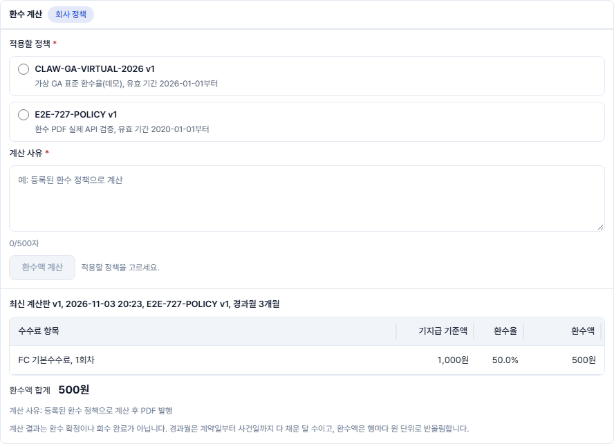
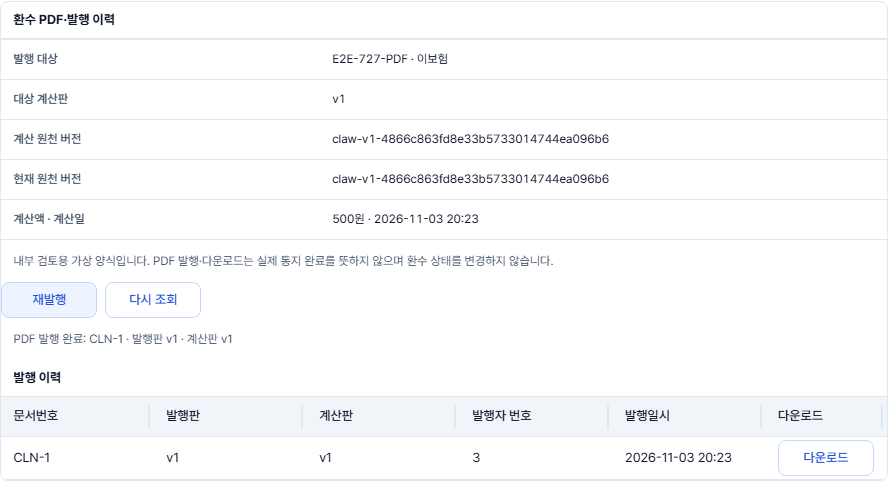
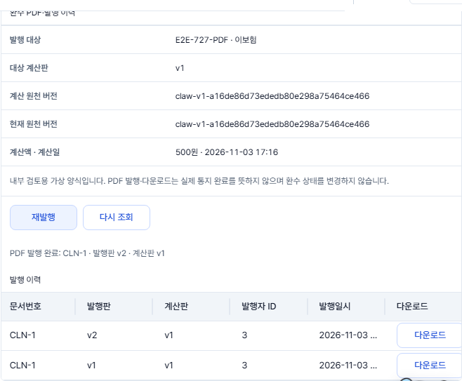
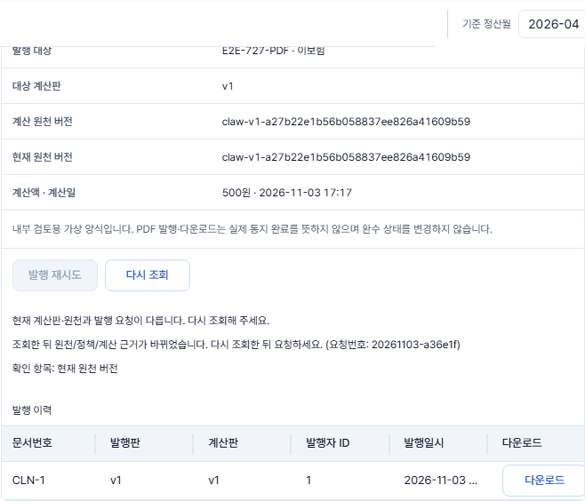
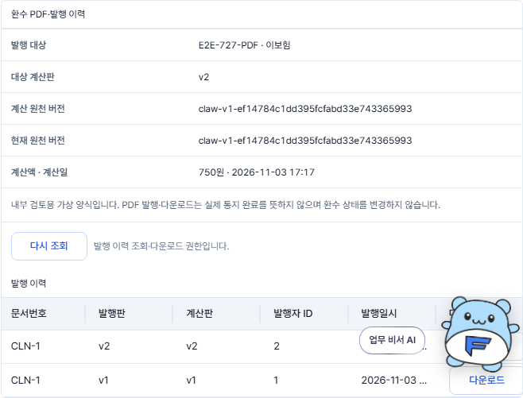
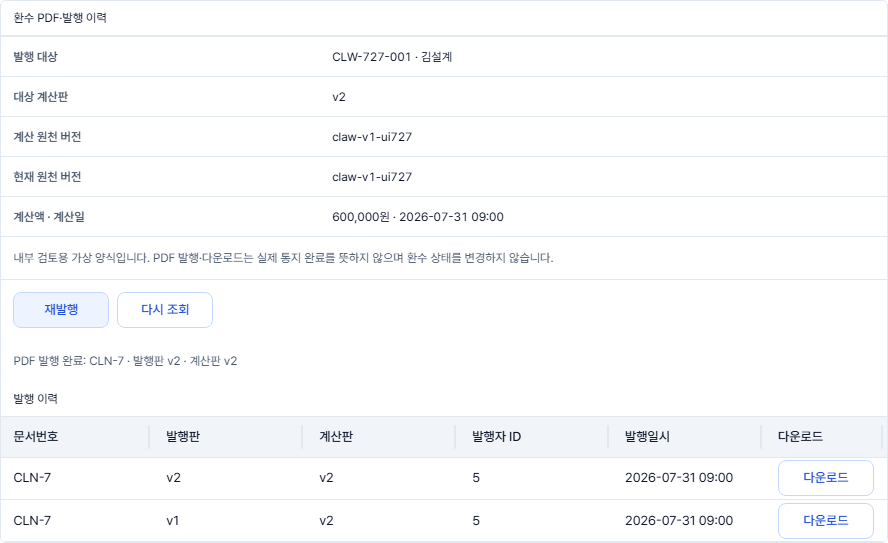
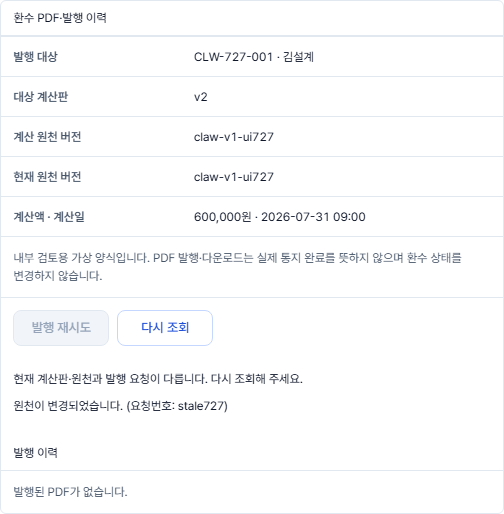
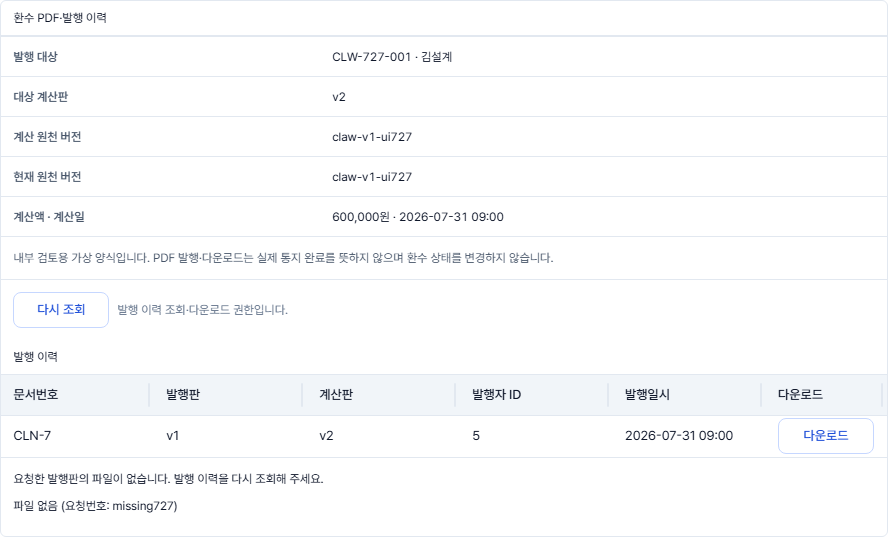

# #727 CLAW-W01 환수 PDF·발행 이력 검증

문서 버전: v3.0-impl-20261103-727 · 검증일: 2026-11-03 (Asia/Seoul)

최종 상태: Docker 연결·가이드 오류·시험 환경 격리를 확인하고 #829 계산 화면과 최신 develop을 통합했다. PR 직전 최종 기준(`95ffafdd` 위 작업본)에서 전체 프런트 1,016개·PostgreSQL 환수 통합 49개·실제 서버 브라우저 5개·PDF UI 브라우저 4개가 모두 통과했다. 정책 선택 → 계산 사유 입력 → 계산 → PDF 생성·다운로드를 실제 API로 검증했다. 초기 기준의 기록은 아래에서 구분한다.

관련 이슈: [#727](https://github.com/feegachu/fgc/issues/727), [FUN-084 #671](https://github.com/feegachu/fgc/issues/671). 선행 PR #802는 2026-11-01 병합됐다. 초기 기준 `ef9922cc`에서 작성한 뒤 계산 화면 #829와 후속 수정이 포함된 최신 develop `95ffafdd`를 통합했다.

## 구현 범위

| 구분 | 변경 내용 |
| --- | --- |
| 변경 전 | PDF API만 존재하고 후보 상세에 발행·이력 UI 없음 |
| 변경 후 | 기존 `/clawbacks`의 상세 아래 PDF 발행·재발행·이력·다운로드 연결 |
| 컴포넌트 | `frontend/src/features/clawback/ClawbackDocuments.tsx` |
| 기능·화면 | FUN-084 · CLAW-W01 |
| API | IF73 POST · IF86 GET · IF67A GET, 기존 계약 유지 |
| 테이블 | 변경 없음 |
| 계산 UI | #829의 정책 선택·계산 사유·IF85 호출·결과 표시를 반영하고 PDF 발행과 연결. 과거 계산판 선택만 후속 범위 |

이력의 발행자 번호는 실제 응답 `createdBy`다. 이름을 합성하지 않는다. PDF 발행/다운로드는 통지 완료·수신 확인·환수 확정으로 표시하지 않는다. 기존 CALCULATE allowedActions와 PDF 발행 역할을 구분한다. GA_ADMIN은 공통 canProcess가 false여도 IF73 권한에 따라 발행한다.

## 최신 계산 화면 통합 검증 (`95ffafdd` 기준)

### PR 직전 최종 재검증

| 검사 | 결과 |
| --- | --- |
| 전체 프런트 단위·커버리지 | **1,016개 통과**, 실패 0. 실제 JWT 전용 5개는 기본 실행에서 건너뜀 (494.96초) |
| 커버리지 | 문장 87.83% · 분기 81.17% · 함수 87.65% · 줄 90.18% |
| 환수 PostgreSQL 통합 | **49개 통과**, 실패·오류·건너뜀 0 (4분 42초) |
| 실제 서버 브라우저 | **5개 통과**: 계산→PDF 흐름 4개와 COMPLIANCE 환수 튜토리얼 6/6단계 완주 (3.7분) |
| PDF UI 브라우저 | **4개 통과**: 동일 키 재시도·새 키 재발행·stale 409·입력 보존·읽기 권한·파일 오류 (13.5초) |
| API 타입·E2E 타입·가이드 2종·린트·프로덕션 빌드 | 통과 |

실제 JWT 전용 5개는 아래 초기 실제 HTTP 검증 기록과 구분한다. 최종 단위 시험의 건너뜀을 통과로 합산하지 않았다. 최신 시험에서 jsdom의 `scrollBy` 미지원 안내는 발생했지만 실패·오류는 없으며 실제 브라우저의 스크롤·강조 위치는 역할 튜토리얼로 확인했다.

초기 PDF 검증은 계산판을 IF85로 미리 만든 상태에서 수행했다. 사용자가 미계산 후보의 계산 버튼을 사용할 수 없던 문제를 해결하기 위해 #829 계산 화면을 현재 PDF 작업본과 통합했다. 계산 중 PDF 발행과 PDF 발행 중 계산을 서로 잠가 이전 계산판으로 쓰기 요청이 겹치지 않게 했다.

- 환수 계산·PDF 컴포넌트 43개 통과, 최신 가이드의 관측 API 유무·배치 정리 시험 5개 통과.
- 실제 서버 브라우저 **4개 모두 통과**(2.6분): 기존 가상 GA 정책 계산 화면, 화면에서 새 후보의 정책·사유 입력 → IF85 계산 → IF73 PDF 발행 → 실제 PDF 다운로드, 응답 유실/재발행, stale 409/과거판/역할 검사.
- 위 새 흐름에서는 IF85를 준비 단계에서 호출하지 않았다. 사용자가 누르는 계산 버튼으로 최초 계산판(500원)을 만들고, 그 계산판의 PDF를 발행해 다운로드 SHA256을 발행 응답과 대조했다.
- 최신 빌드·린트·API 타입·E2E 타입·가이드 검사 통과. 가이드 대상 655개·문구 위치 1,114개.
- 사용 중인 개발 서버(5173)가 `ClawbackCalculation`과 계산 사유 입력란을 제공하고 API 서버(8081)가 정상인 것도 읽기 요청으로 확인했다.

### 사용 순서

1. 환수 메뉴에서 후보를 선택한다.
2. **적용할 정책**을 선택한다. 정책이 하나면 자동 선택된다.
3. **계산 사유**를 1~500자로 입력하고 **환수액 계산**을 누른다.
4. 최신 계산판·항목별 환수액·합계를 확인한다.
5. 아래 **PDF 생성**을 누르고 발행 이력에서 **다운로드**한다.





## 검증 구분

| 완료 기준 | 검증 방법·증거 | 결과 |
| --- | --- | --- |
| 표시한 계산판·원천 버전·발행 대상과 요청 일치 | IF85 실제 계산 응답·IF73 요청 본문·DB snapshot 대조 | UI·실제 API 통과 |
| 중복 클릭·응답 유실 | 실제 서버 커밋 후 응답만 유실, 같은 키 재시도에서 발행판 1 유지·DB 이력 1건 | UI·실제 API 통과 |
| 새 재발행·과거판 | 새 키로 2판, 이전 파일 다운로드 SHA256 보존·응답 해시 대조 | UI·실제 API 통과 |
| 실패를 성공/0건으로 바꾸지 않음 | 로딩·정상 0건·깨진 이력 응답·401·403·409·422·500·파일 없음 | 컴포넌트/공통 클라이언트 검증 |
| null/0·서울 시각 | 미계산/자료 없음과 실제 0원 구분, UTC 00:00 → 서울 09:00 | 컴포넌트 검증 |
| 권한 | 내부 3역할 발행, COMPLIANCE 조회/다운로드, AGENT/미등록 역할 영역·요청 없음, GA_ADMIN canProcess=false | UI 검증 |
| 실패 JSON 저장 방지 | PDF Accept·MIME·`%PDF-` 헤더 검사, 실패 시 object URL/다운로드 생성 없음 | 공통 클라이언트 + UI + 브라우저 검증 |
| 늦은 응답·조회 중 잠금 | 다른 후보에 이전 발행 성공 결과 노출 없음, 상세 갱신 중 발행/다운로드 잠금 | 컴포넌트 검증 |
| 입력·페이지 | PDF 409 재조회 후 검색 초안 보존, 발행 이력 페이지 독립 조회 | 브라우저 + 컴포넌트 검증 |
| 실제 금액·합계·판·원천·해시·환수 상태 불변 | PostgreSQL 통합 49개 + 실제 서버 브라우저(초기 기준 2개), PDF 바이트 SHA256·DB snapshot·case 전후 대조 | **통과** |
| 직접 URL/ID 서버 범위·AGENT 403 | 실제 API의 AGENT 이력/발행/다운로드/후보 상세 모두 403, COMPLIANCE 발행 403·다운로드 200·없는 판 404 | **통과** |

## 실행 명령

프런트 공통 계약·가이드·타입·린트·빌드:

```powershell
cd frontend
npm run check:api
npm run check:guide-features
npm run check:guide-knowledge
npm run check:e2e
npx tsc --ignoreConfig --noEmit --target es2023 --module esnext --moduleResolution bundler --skipLibCheck e2e/clawback-documents.spec.ts
npm run lint
npm run build
```

동작 검증:

```powershell
npm test -- --run src/features/clawback src/lib/api/client.test.ts src/lib/exportCsv.test.ts src/features/assistant/workflow-catalog.test.tsx --maxWorkers=2
npm run test:coverage -- --maxWorkers=4 --testTimeout=15000
npx playwright test --workers=2
```

단위 테스트는 실제 브라우저/서버로 간주하지 않는다. `frontend/e2e/clawback-documents.spec.ts`는 브라우저에서 동작하는 **API fixture 시험**이다. 실제 저장 파일·금액·서버 권한을 검증하는 CT-W02와 구분한다.

## 실제 DB/API 시험 결과

초기에는 Docker Desktop의 `dockerInference` 소켓 오류로 시험을 실행하지 못했다. 후속 검증에서 Docker Engine 29.7.2의 정상 구동을 확인하고, Windows 소켓 접근 권한이 허용된 실행 환경에서 아래 통합 시험 **49개 전부 통과**했다. 기존 개발 DB(`fgc-db`, 5433)를 사용하지 않았으며 각 통합 시험은 Testcontainers PostgreSQL 17로 실행했다.

```powershell
.\gradlew.bat test --tests '*ClawbackNoticeDocumentIntegrationTest' --tests '*ClawbackCalculation*' --tests '*ClawbackCandidate*' bootJar
```

| 시험 | 건수 | 실패·오류·건너뜀 |
| --- | --- | --- |
| ClawbackCandidateIntegrationTest | 21 | 모두 0 |
| ClawbackCalculationIntegrationTest | 12 | 모두 0 |
| ClawbackNoticeDocumentIntegrationTest (CT-W02) | 16 | 모두 0 |

초기 실제 브라우저 검증은 `frontend/e2e-demo/clawback-documents.spec.ts`에서 추가했고 **2개 모두 통과**했다(2.8분). Java 21·Node 22.22.2, 실제 Spring Boot 서버(18081)·Vite(15173)·별도 PostgreSQL 17(`fgc-e2e-727`, 55427, `com.fgc.e2e=418`)을 사용했다. 원천 데이터만 해당 일회성 DB에 준비하고 계산·발행·이력·다운로드는 모두 실제 API로 요청했다. 응답 fixture를 사용하지 않았으며, 응답 유실 시험은 실제 발행 커밋 후 브라우저 응답만 끊었다.

```powershell
$env:FGC_E2E_DB_CONTAINER='fgc-e2e-727'
$env:FGC_E2E_DB_PORT='55427'
$env:FGC_STORAGE_ROOT=Join-Path (Resolve-Path ..) '.codex-tmp\issue727-real-files'
npx playwright test --config playwright.demo.config.ts e2e-demo/clawback-documents.spec.ts
```

- 확정 지급 1,000.4원 → 원 단위 기준금액 1,000원 × 실제 정책 50% = 500원을 IF85 응답·DB `result_snapshot`·화면과 대조했다. 실제 PDF 항목·합계 텍스트는 CT-W02 서버 시험에서 대조했다.
- 같은 요청의 응답 유실 뒤 같은 키 재시도는 문서 1판·DB 이력 1건을 유지했고, 새 재발행은 같은 문서번호의 2판을 생성했다. 다운로드 바이트의 SHA256을 각 API 발행 응답과 대조했다.
- 계산 뒤 지급 500원을 추가하면 이전 원천 요청은 실제 409가 된다. 재조회 후 검색 입력을 보존하고, IF85 재계산은 계산 2판·750원을 반환했다. GA_ADMIN이 계산 2판으로 문서 2판을 발행한 뒤에도 과거 문서 1판의 해시는 그대로였다.
- COMPLIANCE는 이력·다운로드만 가능하고 발행은 403이었다. AGENT는 문서 이력·발행·직접 PDF URL·후보 상세 ID 접근 모두 403이었다. 내부 역할의 없는 문서 판 요청은 404였다.
- 발행·재발행·다운로드 전후 status/notice_date/confirmed_amount/calculated_amount/updated_at이 같았고 실제 통지 이력은 0건이었다. 파일 생성 실패·변조·누락·트랜잭션 롤백·동시 발행도 서버 CT-W02에서 검증했다.

일반 프런트 단위 실행에서 건너뛰는 `server.test.ts` 5개는 `OpenApiFrontendIntegrationTest`를 통해 실제 HTTP 서버·일회성 PostgreSQL에서 별도로 실행하여 **모두 통과**했다. 만료 access의 동시 3요청에서 refresh 1회, refresh 쿠키 없음·원 경로 보존, 중복 로그인 처리, 실제 사용자 정보, 정책 API 어댑터까지 확인했다. 서버 OpenAPI를 재추출했으며 생성 스키마·타입의 변경은 없었다.

```powershell
$env:FGC_EXPORT_OPENAPI='true'
$env:FGC_NODE_BIN=(Get-Command node).Source # Node 22
.\gradlew.bat test --tests '*OpenApiFrontendIntegrationTest'
```

검증 종료 후 이번 작업에서 만든 `fgc-e2e-727` 컨테이너를 정리했다. 기존 개발용 `fgc-db`는 정상 구동 상태로 유지했다.

## ResizeObserver 수정

`useSpotlight.ts`가 `ResizeObserver`를 무조건 생성해 jsdom·미지원 환경에서 가이드 마운트가 실패했다. API가 있으면 기존 관측을 유지하고, 없으면 최초 측정·창 크기·스크롤 이벤트로 계속 갱신하도록 수정했다. 이벤트 리스너와 animation frame 정리는 두 환경에서 동일하게 수행한다. 미지원 상태의 최초 측정·창 크기/스크롤 갱신·대상 제거·언마운트 정리와 기존 지원 환경의 카드 위치 고정을 검증했다. 가이드·검증 화면 관련 초기 시험 **22개 통과**. PR 리뷰 반영 후에는 관측 API가 없을 때도 대상 위치와 크기를 100ms 간격으로 확인한다. 창 크기 변경이나 스크롤 없이 패널 크기가 바뀌어도 강조 영역과 안내 카드 위치를 갱신하고, 안내가 닫히면 주기 확인을 종료한다.

전체 시험에서 추가로 드러난 피코 시연 시험 실패는 개인 `.env.local`의 `VITE_ASSISTANT_AI=true`가 시험에 유입된 것이 원인이었다. `vite.config.ts`의 `test.env`에서 AI/시연 opt-in의 기본값만 false로 고정해 시험을 개발자 설정과 분리했다. 개별 실제 AI 모드 시험의 `vi.stubEnv`는 유지되며 제품의 개발·배포 설정은 변경하지 않았다. 해당 피코·안내 시작 시험 **22개 통과**.

## 실행 결과·캡처

| 검사 | 결과 |
| --- | --- |
| API 생성 타입 동기화 | `check:api` 통과, 서버/OpenAPI 변경 없음 |
| 가이드 대상·역할·화면 문구 | `check:guide-features`·`check:guide-knowledge` 통과, 652개 대상·1,107개 위치 등록 |
| E2E 타입 검사 | `check:e2e` 및 새 fixture spec 개별 TypeScript 검사 통과 |
| 린트·프로덕션 빌드 | 통과 |
| 관련 단위·컴포넌트·API 클라이언트·가이드 등록 | **90개 통과**, 5개 파일 (`--maxWorkers=2`, 23.4초) |
| 전체 프런트 단위·커버리지 (초기 기준) | **987개 통과**, 실패 0, 실제 JWT 서버 전용 5개는 아래 별도 실행. 73개 파일 통과·1개 서버 전용 파일 건너뜀 (394.4초) |
| 별도 실제 JWT·프런트 API 연동 | **5개 모두 통과**, 실제 Spring Boot HTTP 서버·Testcontainers PostgreSQL 사용 (프런트 12.3초, Gradle 2분 3초) |
| 커버리지 | 문장 87.48% · 분기 80.97% · 함수 87.07% · 줄 89.80% |
| 전체 브라우저 회귀 (초기 기준) | **101개 통과** (`--workers=2`, 4.3분), 새 #727 시험 4개 포함 |
| Java 소스·테스트 소스 컴파일 | 통과 |
| 실제 PostgreSQL 통합 시험 | **49개 통과**, 실패·오류·건너뜀 0 |
| 실제 서버 브라우저 시험 (초기 기준) | **2개 통과**, API·DB snapshot·PDF 해시·권한·상태 불변 대조 |
| ResizeObserver·검증 화면 회귀 | **22개 통과** |

최초 전체 Vitest 실행의 시간 초과와 `ResizeObserver is not defined`는 후속 검증에서 원인을 구분했다. Node 22 환경에서 가이드의 API 부재 처리와 시험 모드 격리를 수정한 뒤 전체 커버리지 검사가 통과했다. 테스트 본문의 제한 시간·업무 기대값은 변경하지 않았다.

### 실제 API 발행·재발행 이력



### 실제 원천 변경 409



### 실제 COMPLIANCE 읽기 전용



아래는 초기 단계의 API fixture 브라우저 캡처이며 위 실제 DB/API 검증과 구분한다.

### 발행·재발행·과거판 이력



### 오래된 원천 요청 409



### COMPLIANCE 읽기 전용·파일 없음


