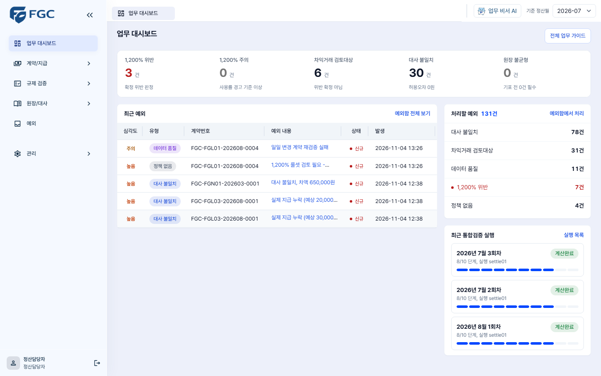
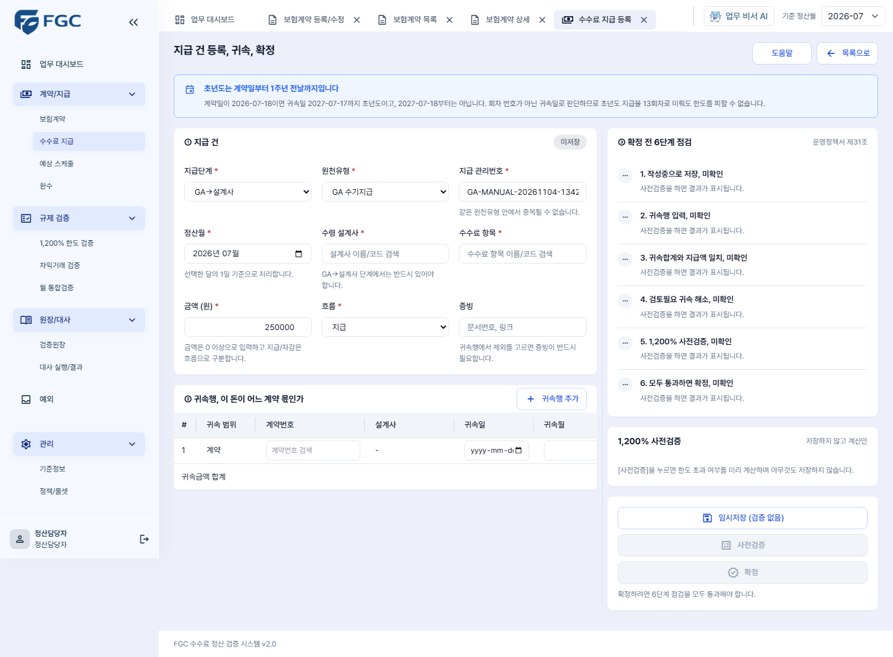
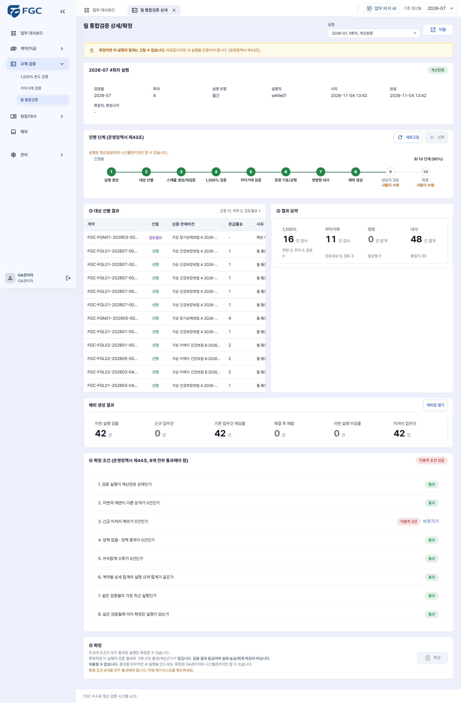
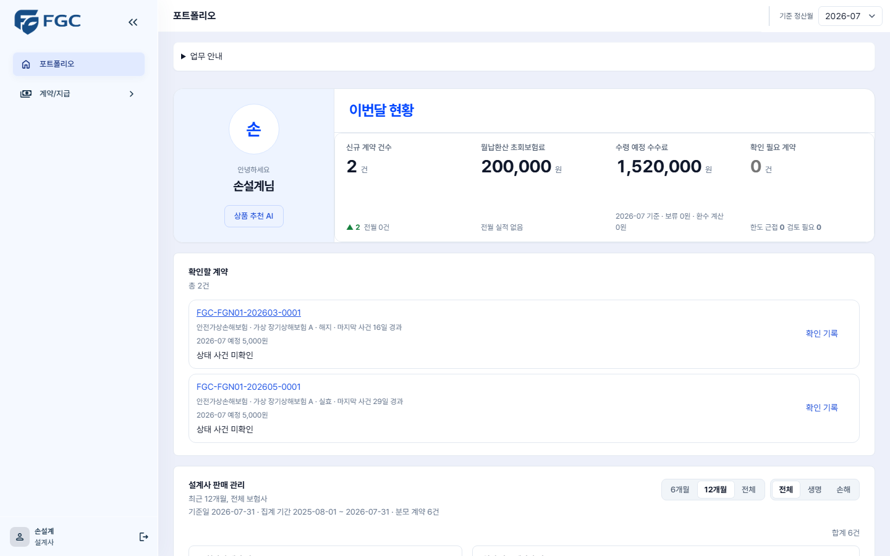

# FGC 사용자, 관리자 매뉴얼 v1.0

| 항목 | 내용 |
|---|---|
| 요구사항 | FGC-PSR-004 사용자, 관리자 매뉴얼 (요구사항명세서 v3.0 PSR 시트. 원 근거 SRC-006은 근거대장에 "누락"으로 원문이 없다) |
| 인수조건 | 매뉴얼만 받은 사용자가 핵심 업무 시나리오를 수행할 수 있다 |
| 기준 코드 | develop `5f21741a` (2026-11-04). 화면 문구와 메뉴 이름은 이 커밋의 `frontend/src`에서 옮겼다 |
| 화면 기준 | `docs/FGC_화면정의서_v3_0.md`. 화면 ID의 전체 이름은 `FGC-UI-<ID>`다 (예: `FGC-UI-CONT-W01`) |
| 장애와 운영 | 시스템 관리자 절차의 명령은 `docs/FGC_운영_장애대응_Runbook_v1_0.md`에 있다 |
| 검증 | 버튼과 문구를 `5f21741a` 소스와 대조했다. 실제 화면 순회는 `274477d6` 기준이다(Runbook 부록 A T25). 그 뒤 들어온 로그인 시도 제한 안내, 상태이력, 영향 미리보기, 월 통합검증 재시작 창, 수수료 명세는 소스 대조만 했다. 캡처는 `274477d6` 때 찍은 격리 환경의 합성 데이터라 그 뒤 바뀐 화면과 다를 수 있다. 사람이 이 매뉴얼만 보고 수행한 기록은 8-8절에 적는다 |

**표기**

- `[버튼]`: 화면에 있는 버튼 글자 그대로다.
- `'입력칸'`: 입력칸 이름이나 화면에 나오는 문구 그대로다.
- `메뉴 > 하위 메뉴`: 왼쪽 메뉴 경로다.
- **아직 없음**: 이 기준 커밋에 들어오지 않은 기능이다. 열린 PR 번호를 함께 적었다. 병합되면 이 표시를 지운다.

이 매뉴얼의 업무 규칙은 새로 정한 것이 없다. 화면이 하는 일을 설명할 뿐이고, 규칙의 근거는 화면정의서, 운영정책서, 규제조문표에 있다. 금액 계산과 한도 판정은 프로그램이 하며, 업무 비서 AI가 만든 설명은 지급 승인이나 확정이 아니다(화면정의서 §2-3, FUN-073).

---

## 1. 시작하기

### 1-1. 로그인 (AUTH-W01)

1. 안내받은 서비스 주소에 접속한다. 주소와 계정은 시스템 관리자에게 받는다. 이 문서에 비밀번호를 적지 않는다.
2. `'아이디'`와 `'비밀번호'`를 입력하고 `[로그인]`을 누른다.
3. 내부 담당자는 `업무 대시보드`(DASH-W01)로, 설계사는 `포트폴리오`(AGNT-W01)로 들어간다.

왼쪽 아래 사용자 이름과 역할이 맞는지 본다. 끝나면 `[로그아웃]`을 누른다.

| 화면 문구 | 뜻 | 할 일 |
|---|---|---|
| `'아이디 또는 비밀번호가 맞지 않습니다.'` | 잘못된 입력, 없는 계정, 잠긴 계정이 모두 같은 문구다 | 다시 입력한다. 계속되면 시스템 관리자에게 계정 상태 확인을 요청한다 |
| `'로그인 시도가 너무 많습니다. 잠시 후 다시 시도해 주세요.'` | 짧은 시간에 로그인 시도가 몰렸다. 이 안내만으로는 비밀번호가 맞는지, 계정 상태가 어떤지 알 수 없다. 같은 공유기를 쓰는 사람의 시도가 함께 세어질 수 있다 | 몇 초 기다렸다가 다시 로그인한다. 여러 명이면 한 명씩 한다. 계속되면 시스템 관리자에게 알린다(Runbook 1-6절) |
| `'로그인이 만료되었습니다. 다시 로그인하세요.'` | 로그인 유지 시간이 지났다 | 다시 로그인한다. 저장 전 입력은 사라질 수 있다 |
| `'다른 곳에서 같은 계정으로 로그인해 로그아웃되었습니다. 다시 로그인하세요.'` | 한 계정은 한 곳에서만 로그인된다 | 공용 계정을 나눠 쓰고 있지 않은지 확인하고 다시 로그인한다 |

### 1-2. 화면 구성

**왼쪽 메뉴.** 역할에 맞는 메뉴만 보인다.

| 메뉴 | 화면 | 화면 ID |
|---|---|---|
| 업무 대시보드 | 오늘 볼 지표, 최근 예외, 최근 통합검증 실행 | DASH-W01 |
| 포트폴리오 | 설계사 본인 현황 (설계사만) | AGNT-W01 |
| 계약/지급 > 보험계약 | 목록, 상세, 등록/수정 | CONT-W01, W02, W03 |
| 계약/지급 > 수수료 지급 | 목록, 등록, 귀속, 확정 | TRAN-W01, W02 |
| 계약/지급 > 수수료 명세 | 설계사별 지급, 보류, 조정, 환수 내역과 근거 | RPT-W02 |
| 계약/지급 > 예상 스케줄 | 목록, 상세, 새 버전 | SCHE-W01, W02 |
| 계약/지급 > 환수 | 후보, 계산, PDF | CLAW-W01 |
| 규제 검증 > 1,200% 한도 검증 | 판정 현황, 계산근거 | CAP-W01, W02 |
| 규제 검증 > 차익거래 검증 | 판정과 재검증 | ARB-W01 |
| 규제 검증 > 월 통합검증 | 실행 목록, 상세, 확정 | VRUN-W01, W02 |
| 원장/대사 > 검증원장 | 분개 조회, 역분개 | LEDG-W01 |
| 원장/대사 > 대사 실행/결과 | 대사 실행, 비교 상세 | RECO-W01, W02 |
| 예외 | 예외함 | EXCP-W01 |
| 관리 > 기준정보 | 조직, 보험회사, 상품, 설계사, 수수료 항목 | BASE-W01 |
| 관리 > 정책/룰셋 | 정책 조회, 작성, 승인 | POL-W01 |
| 관리 > 감사로그 | 감사 기록 (준법/감사, 시스템관리자) | AUDT-W01 |

**위쪽.** 열어 둔 화면이 탭으로 남는다. 오른쪽 `'기준 정산월'`을 바꾸고 `[적용]`을 누르면 열린 탭의 조회 기준이 함께 바뀐다.

- 조회 값을 설명하기 전에 기준 정산월과 화면의 `[조회]` 조건이 같은지 먼저 본다.
- 입력 중에 화면이나 기준월을 바꾸면 `'저장하지 않은 입력이 있어요'` 창이 뜬다. `[현재 입력 유지하고 돌아가기]`를 눌러 먼저 저장한다.

**안내 기능.** 화면 처리를 대신하지 않는다. 실제 저장, 실행, 확정은 사용자가 그 화면의 버튼을 눌러야 일어난다.

- `업무 대시보드`의 `[전체 업무 가이드]`: 정산 업무 순서를 단계별로 안내한다.
- `수수료 지급` 등록 화면의 `[도움말]`: 지급 입력 순서를 안내한다.
- 화면 오른쪽 아래의 `'업무 비서 AI'`(피코): 업무 질문에 답하고 안내를 시작한다. 웹 이미지를 AI 기능을 켜고 빌드한 서버에서만 보인다. AI를 쓸 수 없을 때는 고정 안내로 답한다(1-4절).

### 1-3. 역할별로 할 수 있는 일

코드 기준은 `common/security/Roles.java`와 각 API의 권한 검사다. 화면의 버튼을 숨기는 것과 별개로 서버가 다시 검사한다.

| 업무 | 정산담당자 `SETTLEMENT` | GA관리자 `GA_ADMIN` | 시스템관리자 `SYSTEM_ADMIN` | 준법/감사 `COMPLIANCE` | 설계사 `AGENT` |
|---|---|---|---|---|---|
| 계약, 지급 조회 | O | O | O | O | 본인 것만 |
| 계약 등록, 수정, 스케줄 재생성, 한도 재검증 | O | | O | | |
| 상태 사건 영향 미리보기 | O | O | O | | |
| 지급 등록, 사전검증, 확정 | O | | O | | |
| 수수료 명세 조회 | O | O | O | O | 본인 것만 |
| 예상 스케줄 조회 | O | O | O | O | |
| 스케줄 새 버전, 확정 | O | | O | | |
| 한도, 차익거래, 원장, 대사 결과 조회 | O | O | O | O | |
| 차익거래 재검증, 대사 실행, 불일치 예외 일괄 생성 | O | | O | | |
| 월 통합검증 실행 생성, 실행, 재시작 | O | | O | | |
| 월 통합검증 확정 | | O | O | | |
| 예외 처리, 역분개 | O | O | O | | |
| 환수 조회, 발행 이력 다운로드 | O | O | O | O | |
| 환수 계산, PDF 생성 | O | O | O | | |
| 정책 초안 작성, 제출 | O | O | O | | |
| 정책 승인, 반려, 활성화 | | O | O | | |
| 감사로그 | | | O | O | |
| 상품 추천 AI | | | | | O |

- 조회 역할(`COMPLIANCE`)은 모든 처리 버튼이 꺼져 있다.
- 정책 작성자는 자기 정책을 승인할 수 없다. `SYSTEM_ADMIN`도 같다.
- 지급 확정 차단을 관리자 권한으로 넘기는 버튼은 없다. 규제 위반은 승인으로 넘길 수 없다(화면정의서 TRAN-W02).

### 1-4. 자주 쓰는 공통 동작

| 동작 | 방법 |
|---|---|
| 목록 조회 | 조건을 넣고 `[조회]`. `[초기화]`는 조건을 비운다 |
| 오류가 난 화면 | `[다시 시도]`. 같은 오류면 7장 |
| AI 답변이 고정 문구일 때 | `'지금 AI 답변을 확인할 수 없습니다.'`로 시작하면 AI 호출이 꺼진 상태다. 업무 화면은 그대로 쓸 수 있다. 시스템 관리자가 Runbook 5-4절로 확인한다 |

---

## 2. 정산담당자

### 2-1. 계약 등록 (CONT-W03)

`계약/지급 > 보험계약`에서 `[신규 등록]`을 누른다.

| 순서 | 입력칸 | 주의 |
|---|---|---|
| 1 | `'보험회사'` | 목록에서 고른다 |
| 2 | `'계약일'` | 미래 날짜는 저장되지 않는다 |
| 3 | `'상품 판매버전'` | 검색창에 쓰고 목록의 항목을 직접 고른다. 보험회사와 계약일에 맞는 판매버전만 나온다 |
| 4 | `'계약번호'` | 중복이면 `'저장할 수 없습니다. 이미 등록된 계약번호입니다.'` |
| 5 | `'모집 설계사'` | 이름이나 코드로 검색해 직접 고른다. 고르면 `'소속 조직'`이 자동으로 채워진다 |
| 6 | `'납입주기'`, `'주기 보험료(원)'`, `'초회 보험료(원)'`, `'월납환산 초회보험료(원)'`, `'납입기간(개월)'` | 원주기 보험료와 월납환산 초회보험료를 구분한다 |

`[저장하고 예상 스케줄 만들기]`를 누른다. 성공하면 계약 상세로 이동하고 생성된 스케줄 건수가 안내된다.

`'선택한 상품버전에 적용할 해약환급률표가 없습니다.'`가 보이면 계약은 저장되지만 월 통합검증에서 검토필요로 처리된다. 정책 담당에게 알린다.

### 2-2. 계약 수정과 상태 변경 (CONT-W03)

계약 상세의 `[수정]`을 누른다. 모집 설계사는 수정 화면에서 바꿀 수 없다.

상태를 바꾸기 전에 결과를 먼저 보려면 계약 상세의 `[영향 미리보기]`를 쓴다(2-3절). 상태를 바꿀 때만 다음을 입력한다.

1. `'변경 상태'`를 고른다. `변경 안 함`이면 상태 사건을 만들지 않는다.
2. `'효력일시'`, `'접수일시'`, `'사유코드'`, `'사유'`를 입력한다.
3. `[수정 저장]`을 누르면 `'상태 변경 저장 확인'` 창이 뜬다. 변경 요약을 읽고 `[확인하고 저장]`을 누른다.
4. 상세의 `기본정보` 탭 `'상태이력'`에서 사건과 `'후속 상태'`를 확인한다(2-3절). 저장 성공과 후속 처리 완료는 다르다.

| 화면 문구 | 할 일 |
|---|---|
| `'저장할 수 없습니다. 효력일시는 최신 사건의 효력일시 이후, 접수일시 이전이어야 하고 접수일시는 현재 시각을 넘을 수 없습니다.'` | 날짜를 고친다 |
| `'다른 요청에서 계약을 수정했습니다.'`로 시작하는 문구 | 입력은 유지된다. `[최신 계약 다시 불러오기]` 뒤 변경 내용을 다시 확인한다 |

### 2-3. 계약 상세 확인 (CONT-W02)

탭: `기본정보`, `예상 스케줄`, `1,200%`, `차익거래`, `원장`, `지급/대사`.

버튼: `[수정]`, `[스케줄 재생성]`, `[한도 재검증]`, `[지급 등록]`, `[영향 미리보기]`.

`[한도 재검증]`은 1,200% 판정만 다시 계산한다. 일 배치가 실패한 계약의 전체 복구가 아니므로 이것만으로 예외를 해결 처리하지 않는다(운영정책서 '일일 변경분 처리', SRC-065).

**상태이력.** `기본정보` 탭 `'상태이력'` 표에 사건마다 `'변경 전→후'`, `'효력일시'`, `'접수일시'`, `'처리일시'`, `'처리자'`, `'사유'`, `'후속 상태'`가 나온다. `[효력 순]`, `[접수 순]`으로 정렬한다. 행의 `[영향 보기]`를 누르면 그 사건이 지급 건과 스케줄 회차에 낸 변화와 `'처리/제외 사유'`가 나온다.

| `'후속 상태'` | 뜻 | 할 일 |
|---|---|---|
| `대상 없음` | 이 사건은 후속 처리가 필요 없다 | 없음 |
| `처리 대기`, `처리 중` | 자동 처리 중이다 | 기다린다. 화면이 10초마다 다시 조회한다 |
| `실패, 재시도 대기` | 실패했고 자동으로 다시 시도한다. 시도 횟수, 다음 재시도 시각, 실패 사유가 함께 나온다 | 기다린다 |
| `자동 재시도 소진` | 자동 재시도를 모두 썼다. 표 위에 `'자동 재시도를 모두 쓴 후속 처리가 있습니다. 이 계약의 뒤 사건도 함께 멈춥니다. 운영 담당 확인이 필요합니다.'`가 나온다 | 시스템 관리자에게 알린다(Runbook 7장). 화면에 다시 시도하는 버튼은 없다 |
| `완료` | 끝났다. 바뀐 대상이 없을 수도 있다 | `[영향 보기]`로 결과를 본다 |

후속 처리가 끝나기 전에는 그 계약의 지급과 스케줄을 확정할 수 없다(2-4, 2-5절).

**영향 미리보기.** 정산담당자, GA관리자, 시스템관리자에게 보인다. `'입력한 사건이 일어났을 때의 조건부 비교입니다. 계약 유지 확률이 아니며 아무것도 저장하지 않습니다.'`

1. `[영향 미리보기]`를 누르고 `'사건 종류'`와 `'효력일시'`를 넣는다. 사건은 지금 상태에서 바꿀 수 있는 것만 나온다.
2. 창 안의 `[영향 미리보기]`를 누른다. `'보류 금액'`, `'기지급액 (변경 전후 같음)'`, `'환수 검토'`, `'멈추는 회차'`, `'재개되는 회차'`, `'바꾸지 않는 회차'`, `'미확정 지급 건 영향'`을 읽는다. `'자료 없음'`과 `'미계산'`은 0원이 아니다.
3. 실제로 바꾸려면 `[계약 수정으로 이동]`을 누른다(정산담당자, 시스템관리자에게 보인다). 수정 화면에 상태와 효력일시가 채워지고 2-2절대로 저장한다. 저장할 때 그 시점의 최신 상태로 다시 검증하므로 결과가 비교와 달라질 수 있다.

| 화면 문구 | 할 일 |
|---|---|
| `낡음`, `'입력이나 계약이 바뀌었습니다. 이 결과는 지금 조건의 결과가 아닙니다. 다시 미리보세요.'` | 창 안의 `[영향 미리보기]`를 다시 누른다 |
| `'앞선 상태 사건의 후속 처리 {n}건이 끝나지 않았습니다. 실제 결과가 이 비교와 달라질 수 있습니다.'` | `'상태이력'`의 `'후속 상태'`를 본다 |
| `'계약일에 적용할 상태별 지급조건 정책을 확인할 수 없어 계산하지 않았습니다. 금액을 0원으로 보지 마세요.'` | 정책 담당에게 알린다 |

### 2-4. 수수료 지급 등록, 귀속, 확정 (TRAN-W02)

`계약/지급 > 수수료 지급`에서 `[신규 등록]`을 누르거나 계약 상세의 `[지급 등록]`을 누른다. 확정 순서는 운영정책서 제31조를 따른다.

**① 지급 건**

| 입력칸 | 주의 |
|---|---|
| `'지급단계'` | `GA→설계사` 또는 `원수사→GA` |
| `'원천유형'` | 기본은 `GA 수기지급` |
| `'지급 관리번호'` | 자동으로 채워진다. 같은 원천유형 안에서 중복될 수 없다 |
| `'정산월'` | 실적 발생월이다 |
| `'수령 설계사'` | `GA→설계사`면 필수다. 관리자수수료는 그 계약 조직의 관리자를 지정한다 |
| `'수수료 항목'`, `'금액 (원)'`, `'흐름'` | **금액 칸과 첫 귀속행 금액에 250,000이 미리 들어 있다. 실제 금액으로 바꾼다.** 흐름은 `지급` 또는 `차감` |
| `'증빙'` | 문서번호나 링크. 제외 항목이면 필수다 |

**② 귀속행** `[귀속행 추가]`로 줄을 넣는다. "이 돈이 어느 계약 몫인가"를 적는 곳이다.

- `'귀속 범위'`, `'계약번호'`, `'귀속일'`, `'귀속월'`, `'귀속금액'`, `'산입 판정'`, `'귀속 방법'`을 입력한다.
- 귀속금액 합계가 지급액과 같아야 한다.
- 초년도 판정은 `'귀속일'`로 한다. 초년도는 계약일부터 1주년 전날까지다.

**③ 확정 전 6단계 점검**

1. `[임시저장 (검증 없음)]`을 누른다. 이미 저장한 초안이면 `[수정 저장]`이다.
2. `[사전검증]`을 누른다. 입력이나 대상이 바뀌면 저장과 사전검증을 다시 한다. 검증하는 동안 입력이 잠긴다(`'내용을 다시 편집하려면 목록에서 이 초안을 다시 여세요.'`).
3. 점검 표를 위에서 아래로 읽는다: `작성중으로 저장`, `귀속행 입력`, `귀속합계와 지급액 일치`, `검토필요 귀속 해소`, `1,200% 사전검증`, `모두 통과하면 확정`.
4. 모두 통과하면 `[확정]`, 확인 창의 `[확정 실행]`을 누른다. 확정 뒤 취소는 별도 취소 절차다.

한도를 넘는 건은 확인 창 버튼이 `[확정 시도, 예외 등록]`으로 바뀐다. 누르면 `'이 건은 확정되지 않고 예외함에 등록됩니다. 지급 건은 작성중으로 남습니다.'` 상태가 되고 `[예외함에서 처리하기]`로 이어진다.

| 화면 문구 | 할 일 |
|---|---|
| `'지급을 확정할 수 없습니다. 이 돈이 어느 계약 몫인지 먼저 입력하세요.'` | 귀속행을 넣는다 |
| `'지급을 확정할 수 없습니다. 귀속금액 합계({a}원)가 지급액({b}원)과 다릅니다. 차액 {c}원.'` | 합계를 맞춘다 |
| `'지급을 확정할 수 없습니다. 검토필요 상태의 귀속행이 있습니다. 예외함에서 먼저 처리하세요.'` | 예외함에서 처리한다 |
| `'지급을 확정할 수 없습니다. 1,200% 한도 초과(사용률 {n}%). 예외함에서 정정/감액/취소를 선택하세요.'` | 예외함에서 처리한다. 초안을 억지로 통과시키지 않는다 |
| `'한도 검증을 보류합니다. 적용 가능한 1,200% 룰셋이 없습니다. 정책을 확인하세요.'` | GA관리자에게 정책 확인을 요청한다 |
| `'저장할 수 없습니다. "제외"를 선택하면 증빙을 입력해야 합니다.'` | `'증빙'`을 넣는다 |
| `'확정할 수 없습니다. 계약 상태 사건으로 보류된 지급 건이거나 후속 처리가 끝나지 않았습니다. 보류 해제 또는 처리 완료 후 다시 확정하세요.'` | 계약 상세의 `'상태이력'`을 본다(2-3절). 처리 중이면 기다린다. 보류는 납입 재개나 부활 사건의 후속 처리로 풀리고, 풀려도 자동으로 확정되지 않는다(운영정책서 제48조). 환수(차감) 건에는 나오지 않는다 |

작성 중인 초안은 목록의 `[수정]`, `[삭제]`로 고치거나 지운다. 삭제한 초안은 복구할 수 없다.

### 2-5. 예상 스케줄 (SCHE-W01, W02)

`계약/지급 > 예상 스케줄`에서 조건을 넣고 `[조회]`, 행의 `[회차 보기]`로 상세에 들어간다. `[CSV 내보내기]`로 받을 수 있다.

- 예상 금액은 실제 지급이 아니다. 실제 지급은 `수수료 지급`에서 본다.
- 정책이나 계약이 바뀌어 다시 만들 때는 `[새 버전 만들기]`를 누르고 사유를 쓴다. 지난 버전은 지우지 않고 `'버전 비교'`에 남는다.
- 확정한 스케줄은 고칠 수 없다. `'수정할 수 없습니다. 확정된 스케줄은 고칠 수 없습니다. 새 버전 만들기를 누르세요.'`
- 보류 회차가 남았거나 후속 처리가 끝나지 않은 계약의 스케줄은 확정할 수 없다. 2-4절 표와 같은 문구가 나온다.

**아직 없음**: 4년, 7년 예정 스케줄 생성과 조회(#822, #828).

### 2-6. 월 통합검증 실행 (VRUN-W01, W02)

1. `규제 검증 > 월 통합검증`의 `'① 새 실행 만들기'`에서 `'검증월'`과 `'실행 유형'`을 고르고 `[실행 생성]`을 누른다. 월 검증은 `월간`을 고른다.
2. 만든 실행의 상세(VRUN-W02)로 바로 이동한다. 나중에 다시 볼 때는 `'② 실행 목록'`에서 그 행의 `[열기]`를 누른다.
3. `[실행]`을 누른다. 요청 접수와 검증 통과는 다르다. 진행 단계가 2초마다 갱신된다.
4. 끝나면 `'③ 대상 선별 결과'`, `'④ 결과 요약'`, `'예외 생성 결과'`를 읽고 `[예외함 열기]`로 넘어간다.
5. 예외를 처리한 뒤 GA관리자에게 확정을 요청한다(3-2절).

| 상황 | 할 일 |
|---|---|
| `'실행을 만들 수 없습니다. 이번 달 검증이 이미 진행 중입니다.'` | 목록에서 진행 중 실행을 연다. 오래 멈춰 있으면 시스템 관리자에게 알린다 (Runbook 6-3절) |
| 단계가 빨갛고 상태가 실패 | `'실패 사유'`를 읽고 원인을 고친 뒤 `[실패 지점부터 재시작]`을 누른다. `'실패 지점 재시작 확인'` 창에서 검증월, 회차, 이어 처리할 단계를 확인하고 `'재시작 사유'`를 쓴 뒤 `[재시작 요청]`을 누른다. 완료한 단계는 다시 하지 않는다. `'요청 접수는 처리 완료가 아닙니다.'` 진행 단계와 `'재시도 이력'`으로 결과를 본다. 끝나도 자동으로 확정되지 않는다 |
| `'이미 재시작 요청이 진행 중입니다.'` 또는 `'같은 월에 다른 실행이 진행 중입니다.'`로 버튼이 꺼져 있음 | 끝날 때까지 기다렸다가 `[새로고침]`을 누른다. 오래 그대로면 시스템 관리자에게 알린다. 멈춘 접수는 승인을 받아 닫는다 (Runbook 6-3절) |
| `'이어서 처리할 체크포인트가 없습니다.'` 또는 `'실패한 배치 실행과 체크포인트를 확인할 수 없습니다.'` | 재시작할 수 없다. 시스템 관리자에게 알린다 (Runbook 6-2절) |
| `'재시작을 기동하지 못했습니다. 실행 이력을 확인한 뒤 다시 시도하세요.'` | `'재시도 이력'`을 보고 다시 시도한다 |
| `'재시작 시도의 진행을 확인하지 못했습니다. 자동 조회를 멈췄습니다. 새로고침으로 상태를 확인하세요.'` | 처리 실패라는 뜻이 아니다. `[새로고침]`을 누르고 `'재시도 이력'`을 본다 |
| 실패한 실행이 `계약수동` 유형 | 재시작 버튼이 없다. 새 실행을 만든다. 일 배치 복구는 시스템 관리자 절차다 (Runbook 3장) |

`'재시도 이력'`의 상태는 `접수됨`, `기동 중`, `진행 중`, `완료`, `실패`다. 재시작 영역의 `'완료 대상'`, `'남은 대상'`은 아직 값이 나오지 않아 `'자료 없음'`으로 보인다.

### 2-7. 대사 (RECO-W01, W02)

1. `원장/대사 > 대사 실행/결과`에서 `'정산월'`, `'지급단계'`, `'보험회사'`를 고른다. 지급단계와 보험회사를 하나로 정해야 `[대사 실행]`이 켜진다(`전체 (실행 이력 조회만)`은 이력 조회용이다). 정산월이 기준 정산월과 다르면 `[변경하고 실행]` 창이 뜬다. `'대사 실행 중입니다. 완료될 때까지 결과를 갱신합니다.'`가 사라질 때까지 기다린다.
2. `'실행 요약'`의 대상, 일치, 불일치, 일치율, 차액 합계를 본다.
3. `'대사 결과'`에서 `'결과 유형'`으로 좁히고 행의 `[보기]`를 눌러 비교 상세를 연다. 예상, 실제, 차액 및 분류를 대조한다. 차액은 실제에서 예상을 뺀 금액이다.
4. 불일치를 예외로 넘기려면 `[불일치 예외 일괄 생성]`을 누르고 `[예외함에서 확인]`으로 이동한다.

`'처리할 수 없습니다. 대사 실행이 완료되지 않았습니다. 실행이 끝난 뒤 예외를 생성하세요.'`가 나오면 `'실행 이력'`의 상태가 끝난 뒤 다시 누른다.

### 2-8. 예외 처리 (EXCP-W01)

1. `예외`에서 조건으로 찾고 왼쪽 목록에서 한 건을 고른다.
2. 오른쪽에서 `'검출 이력'`, 계산근거, 참조를 읽어 원인을 확인한다. 원천 자료는 관련 화면에서 고친다. 예외 상태를 바꾼다고 원천이 고쳐지지 않는다.
3. `'처리'`에서 `'조치'`를 고르고 `'처리 사유'`를 쓴다. 문서번호나 링크가 있으면 `'증빙'`에 넣는다. `[처리 저장]`을 누른다.

| 현재 상태 | 고를 수 있는 조치 | 결과 |
|---|---|---|
| 신규 | `검토 시작` | 검토중 |
| 신규, 검토중 | `담당 배정`, `의견` | 상태 그대로 |
| 검토중 | `정정`, `감액`, `취소`, `이연`, `재대사`, `해결` | 해결 |
| 검토중 | `오탐`, `반려` | 오탐/반려 |
| 오탐/반려 | `재검토 시작` | 검토중 |

`'처리 이력'`은 고치거나 지울 수 없다.

| 화면 문구 | 할 일 |
|---|---|
| `'저장할 수 없습니다. 처리 사유를 입력하세요.'` | 사유를 쓴다 |
| `'처리할 수 없습니다. 현재 예외 상태에서는 요청한 조치를 수행할 수 없습니다.'` | 상태를 다시 보고 허용된 조치를 고른다 |

`일일 변경 계약 재검증 실패` 예외는 원인을 고쳐도 다음 일 배치가 저절로 다시 보지 않을 수 있다. 해결 처리하지 말고 시스템 관리자에게 넘긴다(Runbook 3장, SRC-065).

### 2-9. 환수 검토와 계산 (CLAW-W01)

1. `계약/지급 > 환수`에서 `'기간 기준'`(발생기준일, 계약일), `'시작일'`, `'종료일'` 등을 넣고 `[조회]`를 누른다. 기간의 기본값은 기준 정산월이다.
2. `'② 환수 검토 후보'`에서 처리할 후보를 직접 고른다. 원천 사건, 연결 지급과 귀속, 지급 스케줄을 확인한다.
3. `'환수 계산'`에서 `'적용할 정책'`을 고르고 `'계산 사유'`를 쓴 뒤 `[환수액 계산]`을 누른다.
4. `'환수 PDF·발행 이력'`에서 `[PDF 생성]`을 누른다. 이미 발행했으면 `[재발행]`이다. `'발행 이력'`의 `[다운로드]`로 받는다.

계산은 환수 확정이나 회수 완료가 아니다. `'내부 검토용 가상 양식입니다. PDF 발행·다운로드는 실제 통지 완료를 뜻하지 않으며 환수 상태를 변경하지 않습니다.'`

`'계산한 뒤 원천이나 정책이 바뀌었습니다. 이 계산판은 지금 근거와 다르니 다시 계산하세요.'`가 보이면 다시 계산한 뒤 발행한다.

### 2-10. 한도, 차익거래, 원장 확인

- **1,200% 한도 (CAP-W01, W02)**: `'계약별 판정 목록'`에서 행의 계산근거를 연다. `'설계사별 합계'`는 모니터링 지표이고 규제 판정이 아니다.
- **차익거래 (ARB-W01)**: 왼쪽 `'③ 계약별 판정'`에서 고르고 `'④ 상세'`를 본다. `이상없음`, `검토대상`, `자료부족`으로 나뉜다. `[이 계약만 다시 검증]`은 `GA→설계사` 단계에서만 되고, 창에서 `'검증 기준일'`과 `'재검증 사유'`를 넣고 `[재검증 실행]`을 누른다.
- **검증원장 (LEDG-W01)**: 회사의 정식 회계장부가 아니다(화면정의서 LEDG-W01). 분개는 고치지 않는다. 바로잡을 때 `[역분개]` 또는 `[역분개 + 재기표]`를 쓴다.

---

## 3. GA 관리자

### 3-1. 정책 검토, 승인, 활성화 (POL-W01)

`관리 > 정책/룰셋`에서 `'적용 기준일'`을 정하고 `정책 버전` 탭에서 행의 `선택`을 고른 뒤 `[선택 정책 관리]`를 누른다. `관리 상세` 탭이 열린다.

| 정책 상태 | 쓸 수 있는 버튼 | 누가 |
|---|---|---|
| 작성중 | `[초안 수정]`, `[제출]` | 정산담당자, GA관리자, 시스템관리자 |
| 검토중 | `[승인]`, `[반려]` | GA관리자, 시스템관리자. 작성에 참여했으면 `[반려]`만 |
| 승인 | `[활성화]`, `[새 버전 작성]` | 활성화는 GA관리자, 시스템관리자 |
| 적용중, 종료 | `[새 버전 작성]` | 정산담당자, GA관리자, 시스템관리자 |

버튼은 화면에서 작성할 수 있는 정책 유형에만 나온다(현행, 4년, 7년 수수료, 상태별 지급조건, 차익거래, 대사 허용오차, 환수). 그 밖의 유형은 `'이 정책은 조회만 할 수 있습니다.'`로 조회만 된다.

1. 새 정책은 `[정책 등록]`을 누른다. 정책 유형에 맞춰 `기본정보`, `수수료 규칙`, `분급 룰셋`, `상태별 지급조건`, `환수 규칙`, `근거 자료`를 채우고 `[초안 저장]`을 누른다.
2. `[제출]`을 누르고 `'작업 사유'`를 쓴다.
3. 승인자는 규칙과 근거를 읽고 `[승인]`을 누른다. 근거 문서가 있으면 `'승인 근거 문서'`에 적는다. 돌려보낼 때는 `[반려]`와 `'반려 사유'`를 쓴다.
4. `[활성화]`를 누른다. `'이 버전의 적용일 당일부터 체결한 계약에 새 기준을 적용합니다. 이전 계약은 기존 버전과 요율을 유지합니다.'`
5. `관리 상세`의 `승인 이력`에서 제출, 승인, 반려, 활성화 기록을 확인한다.

| 화면 문구 | 할 일 |
|---|---|
| `'승인할 수 없습니다. 작성자는 자기 정책을 승인할 수 없습니다.'` | 다른 승인자에게 넘긴다 |
| `'처리할 수 없습니다. 적용 범위 또는 기간이 겹치는 정책/규칙이 있습니다.'` | 기간이나 범위를 고친다 |
| `'처리할 수 없습니다. 현재 정책 상태에서 이 동작을 할 수 없습니다. 다시 조회하세요.'` | 다시 조회해 상태를 본다 |

### 3-2. 월 통합검증 확정 (VRUN-W02)

1. `규제 검증 > 월 통합검증`에서 대상 실행의 `[열기]`를 누른다.
2. `'⑤ 확정 조건'`의 8개가 모두 통과인지 본다. 통과하지 못한 행은 `바로가기`로 가서 처리한다. 모두 통과해야 `[확정]`이 켜진다.
3. `'⑥ 확정'`의 `[확정]`을 누르고 창의 안내를 읽은 뒤 다시 `[확정]`을 누른다.

확정하면 결과와 그때 쓰인 룰셋, 계산근거가 잠기고 되돌릴 수 없다. `'검증 결과 잠금이며 실제 송금/회계 마감이 아닙니다.'` 고쳐야 하면 새 실행을 만든다. `계약수동` 실행은 확정 대상이 아니다.

`'확정할 수 없습니다. {n}개 조건이 남았습니다. 아래 체크리스트를 확인하세요.'`는 조건을 처리한 뒤 다시 시도한다.

### 3-3. 운영 복구 승인

다음 복구는 GA관리자의 승인과 사유를 받아야 시스템 관리자가 실행할 수 있다(SRC-065, 가상 GA 정책). 승인 전에 Runbook의 해당 절을 읽고 재처리 범위를 확인한다.

| 복구 | Runbook | 승인할 때 볼 것 |
|---|---|---|
| 일 배치 실패 계약의 워터마크 후퇴 | 3장 | 예외, 계약, 실패 실행 번호. 원인이 고쳐졌는가. 함께 다시 처리될 계약 목록 |
| 소진된 상태 사건 후속 작업 재시도 | 7장 | 사건 번호, 처리 작업 이름, 실패 사유, 원인이 고쳐졌는가 |
| 멈춘 실행을 실패로 표시 | 6-3절 | 실행 번호, API 재기동 시각, 진행 중인 처리가 없는 근거 |
| 재시작 도중 멈춘 접수 닫기 | 6-3절 | 접수 번호, 실행 상태, API 재기동 시각, 진행 중인 처리가 없는 근거 |

GA관리자는 정산담당자와 같이 예외 처리, 역분개, 환수 계산도 할 수 있다(2-8, 2-9, 2-10절).

---

## 4. 시스템 관리자

시스템관리자 역할은 모든 내부 업무 화면을 쓸 수 있다. 업무 처리는 담당 역할에게 맡기고, 아래 운영을 맡는다.

### 4-1. 사용자와 계정

**아직 없음**: 사용자, 역할 관리 화면(ADMN-W01, FUN-003 후순위)과 화면에서 비밀번호를 바꾸는 기능. 그때까지 계정 변경은 DB 절차로 한다.

| 하려는 일 | 방법 |
|---|---|
| 데모 계정 비밀번호 변경, 잠금, 세션 끊기 | Runbook 4-2절 |
| 옛 비밀번호 거절 확인 | Runbook 4-3절 |
| 설계사 시연 계정 `agent01` 활성화 | Runbook 4-5절 |
| 로그인 이력 확인 | `관리 > 감사로그`에서 `'행위 종류'`로 찾는다. 로그인 실패도 기록된다 |

공개 저장소의 시드 비밀번호가 남은 계정은 외부 공개 서버에 두지 않는다(SRC-065).

### 4-2. 감사로그 (AUDT-W01)

`관리 > 감사로그`에서 `'발생 시각 (시작)'`, `'발생 시각 (끝)'`, `'행위자'`, `'행위 종류'`, `'대상 종류'`, `'대상 번호'`로 찾는다. 행을 고르면 `'변경 내용 비교'`에 이전값과 이후값이 나온다. 감사 기록은 지울 수 없다.

Runbook 절차가 남긴 행위 코드: `DEMO_ACCOUNT_PROTECT`, `BATCH_WATERMARK_REWIND`, `CONTRACT_EVENT_JOB_MANUAL_RETRY`, `VALIDATION_RUN_FORCED_FAILED`, `VALIDATION_RUN_RETRY_FORCED_CLOSED`.

### 4-3. 배포

배포 실행은 PM, 운영 승인은 PL이 한다(`Jenkinsfile.fgc`, `Jenkinsfile.shinhan`의 승인 단계). 다시 빌드하지 않고 검증한 이미지를 승격한다. 명령과 실패 시 판단은 Runbook 2장을 따른다.

| 환경 | Jenkins 작업 | 입력 |
|---|---|---|
| 개발계 | `dev-fgc` | develop 병합 뒤 |
| 검증계 | `stage-fgc` | `SOURCE_BUILD`: 개발계 성공 빌드 번호 |
| AWS 운영 | `release-fgc` | `SOURCE_BUILD`: 검증계 빌드 번호, `RFC_URL`. 롤백은 `ROLLBACK` |
| 신한 서버 (11/18 발표) | `release-shinhan-fgc` | `SOURCE_BUILD`: 검증계 빌드 번호, `PRD_URL`, `RFC_URL` |

### 4-4. 장애가 나면

1. Runbook 맨 앞 "장애 대응 한 장"을 연다.
2. 사용자가 요청번호를 알려 주면 그 번호로 로그와 감사로그를 찾는다.
3. 사후 기록을 남긴다(Runbook 1-4절).

---

## 5. 조회 역할 (준법/감사)

`COMPLIANCE` 역할은 모든 내부 화면을 조회하고 감사로그를 볼 수 있다. 처리 버튼은 꺼져 있고, 눌러도 서버가 `'이 작업을 할 권한이 없습니다.'`로 거절한다.

자주 쓰는 점검 경로:

| 점검 | 화면 | 볼 것 |
|---|---|---|
| 1,200% 판정 근거 | `규제 검증 > 1,200% 한도 검증` | 계약별 판정, 계산근거, 룰셋 버전 |
| 차익거래 판정 | `규제 검증 > 차익거래 검증` | 판정, 상세의 계산 값과 사유 |
| 예외 처리 이력 | `예외` | `'처리 이력'`, `'검출 이력'` |
| 확정 결과 | `규제 검증 > 월 통합검증` | 확정자, 확정시각, 확정 조건 |
| 정책 승인 | `관리 > 정책/룰셋` | `'승인 이력'`, `'정책 근거 자료'` |
| 누가 무엇을 바꿨나 | `관리 > 감사로그` | 행위자, 이전값, 이후값, `'사유 원문 보기'` |

---

## 6. 설계사

설계사 계정은 본인 데이터만 본다. 다른 계약 주소를 직접 입력해도 서버가 `'본인 담당 자료만 조회/처리할 수 있습니다.'`로 거절한다(FUN-085).

| 하려는 일 | 메뉴 | 볼 것 |
|---|---|---|
| 이번 달 현황 | `포트폴리오` | `'이번달 현황'`: 신규 계약 건수, 월납환산 초회보험료, 수령 예정 수수료, 확인 필요 계약 |
| 확인할 계약 | `포트폴리오`의 `'확인할 계약'` | 행의 `[확인 기록]`을 눌러 `'확인 결과'`(`종결`, `후속 확인 필요`), `'다음 확인일'`, `'메모'`를 넣고 저장한다. 기록은 쌓이고 같은 사건은 다시 뜨지 않는다 |
| 본인 계약 | `계약/지급 > 보험계약` | 검색 뒤 행을 골라 상세를 연다 |
| 본인 지급 내역 | `계약/지급 > 수수료 지급` | `'정산월'`을 고르고 조회한다. 예정 수수료와 실제 지급은 다르다 |
| 수수료 명세 | `계약/지급 > 수수료 명세`, `포트폴리오`의 `'수령 예정 수수료'` | `'기준월'`을 고르고 조회한다. 지급, 보류, 조정, 환수 요약과 `'명세 내역'`이 나오고 행의 `[근거 보기]`로 `'명세 근거'`를 연다. 환수는 `'환수 계산액이며 실제 회수 완료액이 아닙니다'`. 내부 담당자는 `'설계사'`를 골라 조회한다 |
| 상품 비교 참고 | `포트폴리오`의 `[상품 추천 AI]` | 상품군을 고르면 참고 순위와 근거가 나온다. 산식은 프로젝트 가정이다(D-01, `compare-net-v1`) |

지급 내용이 다르면 계약번호와 정산월을 적어 내부 담당자에게 확인을 요청한다. 설계사는 계약 수정, 지급 확정, 검증, 대사, 정책 화면을 쓰지 않는다.

---

## 7. 오류가 나면

화면에 코드는 나오지 않고 문구와 요청번호가 나온다(SIR-007). 요청번호를 함께 전달한다.

| 화면 문구 | 뜻 | 사용자 | 안 되면 |
|---|---|---|---|
| `'이 작업을 할 권한이 없습니다.'` | 역할에 없는 작업 | 담당 역할에게 넘긴다 | 역할이 틀렸으면 시스템 관리자 |
| `'요청한 화면이 없습니다.'` | 주소가 틀렸거나 없는 자료 | 왼쪽 메뉴에서 다시 들어간다 | |
| `'입력값을 확인하세요.'` | 입력 형식 오류 | 표시된 칸을 고친다 | |
| `'조회한 뒤 원천/정책/계산 근거가 바뀌었습니다. 다시 조회한 뒤 요청하세요.'` | 다른 사람이나 배치가 먼저 바꿈 | 다시 조회한다 | |
| `'같은 요청을 처리하고 있습니다. 잠시 후 다시 시도하세요.'` | 중복 클릭 | 기다렸다가 다시 조회한다 | |
| `'같은 요청이 다른 내용으로 이미 접수됐습니다. 화면을 새로 열고 다시 시도하세요.'` | 입력이 바뀐 재전송 | 화면을 새로 연다 | |
| `'상태를 변경할 수 없습니다. 그 사이 다른 요청이 상태를 바꿨습니다. 다시 조회 후 시도하세요.'` | 실행 상태 경합 | 다시 조회한다 | 계속되면 Runbook 6장 |
| `'처리 중 오류가 발생했습니다. 요청번호 {requestId}를 담당자에게 알려주세요.'` | 서버 오류 | 요청번호를 전달한다 | Runbook 1-3절 |
| 환수 PDF 생성에서 위 문구 | 저장 공간 부족일 수 있다 | 요청번호를 전달한다. 저장된 판은 없다 | Runbook 8장 |
| `'AI 응답을 받지 못했습니다. 잠시 후 다시 시도하세요.'` | AI 호출 실패 | 업무 화면으로 계속한다 | Runbook 5-4절 |
| `'지금 AI 답변을 확인할 수 없습니다.'`로 시작 | AI 꺼짐 또는 쿼터 소진 | 고정 안내를 쓴다 | Runbook 5-4절 |
| 로그인 뒤 화면이 비거나 모든 요청이 실패 | 서버 장애 가능 | 시스템 관리자에게 알린다 | Runbook 장애 대응 한 장 |

---

## 8. 핵심 시나리오 따라 하기

매뉴얼만 받은 사용자가 그대로 따라 할 수 있는 순서다. 값은 그 환경의 시드나 담당자가 준 값을 쓴다. 각 시나리오의 끝에 "확인"을 본다. 수행 결과 표는 8-8절에 적는다.

### 8-1. 계약 등록에서 지급 확정까지 (정산담당자)

1. `계약/지급 > 보험계약` > `[신규 등록]`, 2-1절 표대로 입력, `[저장하고 예상 스케줄 만들기]`.
2. 상세의 `예상 스케줄` 탭에서 회차를 본다.
3. `[지급 등록]`, 2-4절대로 지급 건과 귀속행을 넣는다.
4. `[임시저장 (검증 없음)]`, `[사전검증]`, `[확정]`, `[확정 실행]`.
5. **확인**: `계약/지급 > 수수료 지급` 목록에서 상태가 확정이고, 계약 상세 `1,200%` 탭의 산입액이 늘었다.

### 8-2. 한도 초과 지급을 막고 예외로 넘기기 (정산담당자)

1. 8-1의 3번에서 잔여 한도보다 큰 금액을 넣는다.
2. `[사전검증]`: `1,200% 사전검증`이 막힌다.
3. `[확정]`, `[확정 시도, 예외 등록]`, `[예외함에서 처리하기]`.
4. `예외`에서 그 건을 고르고 `'조치'`를 고른 뒤 `'처리 사유'`를 쓰고 `[처리 저장]`.
5. **확인**: 지급 건은 작성중이고 예외 `'처리 이력'`에 기록이 있다.

### 8-3. 월 통합검증에서 확정까지 (정산담당자 + GA관리자)

1. 정산담당자: `[실행 생성]`, 상세로 이동, `[실행]`, 결과 확인.
2. 정산담당자: `[예외함 열기]`, 긴급 예외를 처리한다.
3. GA관리자: 같은 실행을 열어 `'⑤ 확정 조건'` 8개를 본다.
4. GA관리자: `[확정]`.
5. **확인**: 상태가 확정이고 확정자와 확정시각이 보인다. `[실행]` 버튼이 없다.

### 8-4. 대사 불일치를 예외로 처리하기 (정산담당자)

1. `[대사 실행]`, 완료 대기.
2. `'결과 유형'`으로 불일치를 좁히고 `[보기]`로 원인을 본다.
3. `[불일치 예외 일괄 생성]`, `[예외함에서 확인]`.
4. 예외 한 건을 `검토 시작`, 원천 수정, `해결` 순서로 처리한다.
5. **확인**: 예외 상태가 해결이고 `'처리 이력'`에 두 줄이 있다.

### 8-5. 정책 초안에서 활성화까지 (정산담당자 + GA관리자)

1. 정산담당자: `[정책 등록]`, 초안 작성, `[초안 저장]`, `[제출]`.
2. GA관리자: 행의 `선택`, `[선택 정책 관리]`, 검토, `[승인]`.
3. GA관리자: `[활성화]`.
4. **확인**: `'승인 이력'`에 제출, 승인, 활성화가 있다. 작성자 계정으로는 `[승인]`이 꺼져 있다.

### 8-6. 환수 검토와 PDF (정산담당자)

1. 기간을 넣고 `[조회]`, 후보 선택, 근거 확인.
2. `'적용할 정책'`, `'계산 사유'`, `[환수액 계산]`.
3. `[PDF 생성]`, `'발행 이력'`의 `[다운로드]`.
4. **확인**: 받은 PDF의 문서번호가 발행 이력과 같다. 환수 상태는 바뀌지 않았다.

### 8-7. 설계사 로그인 (설계사)

1. 설계사 계정으로 로그인한다. `포트폴리오`가 첫 화면이다.
2. `계약/지급 > 보험계약`, 본인 계약 하나의 상세를 연다.
3. `계약/지급 > 수수료 지급`에서 `'정산월'`을 고른다.
4. `[상품 추천 AI]`에서 상품군을 고른다.
5. **확인**: 왼쪽 메뉴에 규제 검증, 원장/대사, 관리가 없다. 다른 설계사 계약 주소를 열면 거절된다.

### 8-8. 수행 결과 기록

| 시나리오 | 수행자 | 일시 | 환경, 커밋 | 결과 | 막힌 곳 (매뉴얼 절) |
|---|---|---|---|---|---|
| 8-1 ~ 8-7 | 미수행 | | | **미확인. 동결 RC로 리허설(11/10) 때 팀원 1명이 매뉴얼만 보고 수행해 채운다** | |

---

## 부록 A. 상태 이름

| 대상 | 코드 | 화면 |
|---|---|---|
| 계약 | `APPLIED`, `ACTIVE`, `UNPAID`, `LAPSED`, `REVIVED`, `CANCELLED`, `TERMINATED`, `MATURED` | 청약, 정상, 미납, 실효, 부활, 청약철회, 해지, 만기 |
| 검증 실행 | `CREATED`, `RUNNING`, `COMPLETED`, `FAILED`, `FINALIZED` | 화면정의서 §4-2 |
| 예외 | `NEW`, `IN_REVIEW`, `RESOLVED`, `REJECTED` | 신규, 검토중, 해결, 오탐/반려 |
| 실행 유형 | `MONTHLY`, `MANUAL_CONTRACT` | 월간, 계약수동 |

## 부록 B. 이 기준 커밋에 아직 없는 기능

| 기능 | 화면 | 상태 (2026-11-04) |
|---|---|---|
| 4년, 7년 예정 스케줄 (FUN-037, 038) | SCHE-W01, W02 | PR #822, #828 |
| 사용자, 역할 관리 (FUN-003) | ADMN-W01 | 후순위 |

## 개정 이력

| 판 | 날짜 | 내용 | 근거 |
|---|---|---|---|
| v1.0 | 2026-11-04 | 최초 작성, #676 | FGC-PSR-004, SRC-065, 화면정의서 v3.0, develop `274477d6` 화면 문구 |
| v1.0 | 2026-11-04 | 병합된 화면 반영: 로그인 시도 제한 안내(1-1절), 상태이력과 영향 미리보기(2-2, 2-3절), 지급과 스케줄 확정 차단 문구(2-4, 2-5절), 재시작 창(2-6절), 수수료 명세(1-2, 1-3, 6장), 피코 위치(1-2절), 검증원장 안내(2-10절), 부록 B | #773, #831, #835, #844, #856, #859, #870, develop `5f21741a` 소스 대조, 운영정책서 제48조, 화면정의서 v3.0, SRC-028 |
