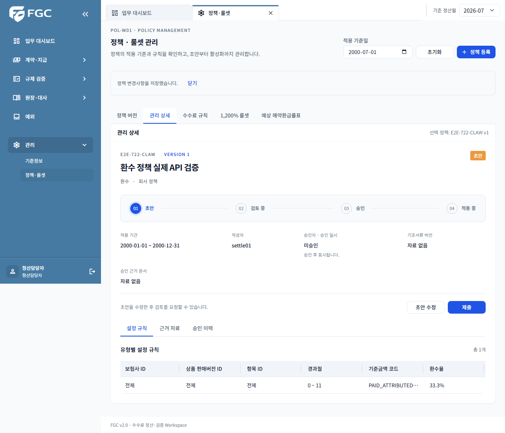
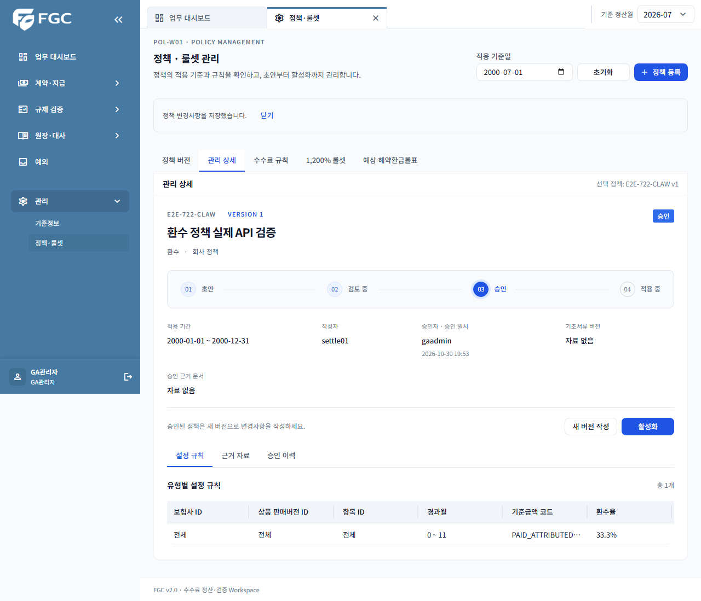
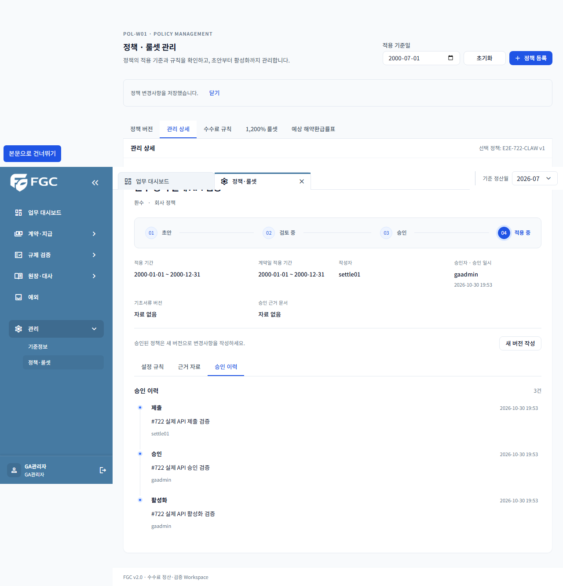
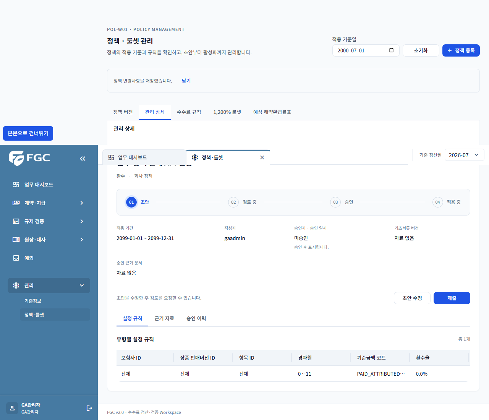
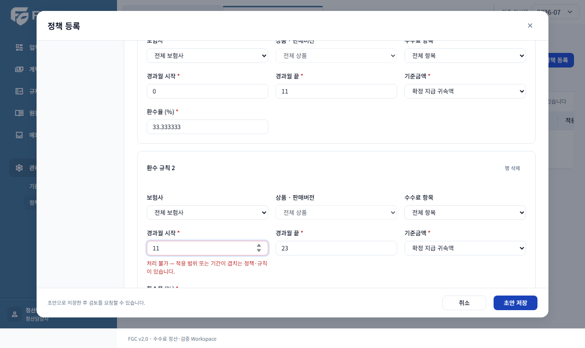
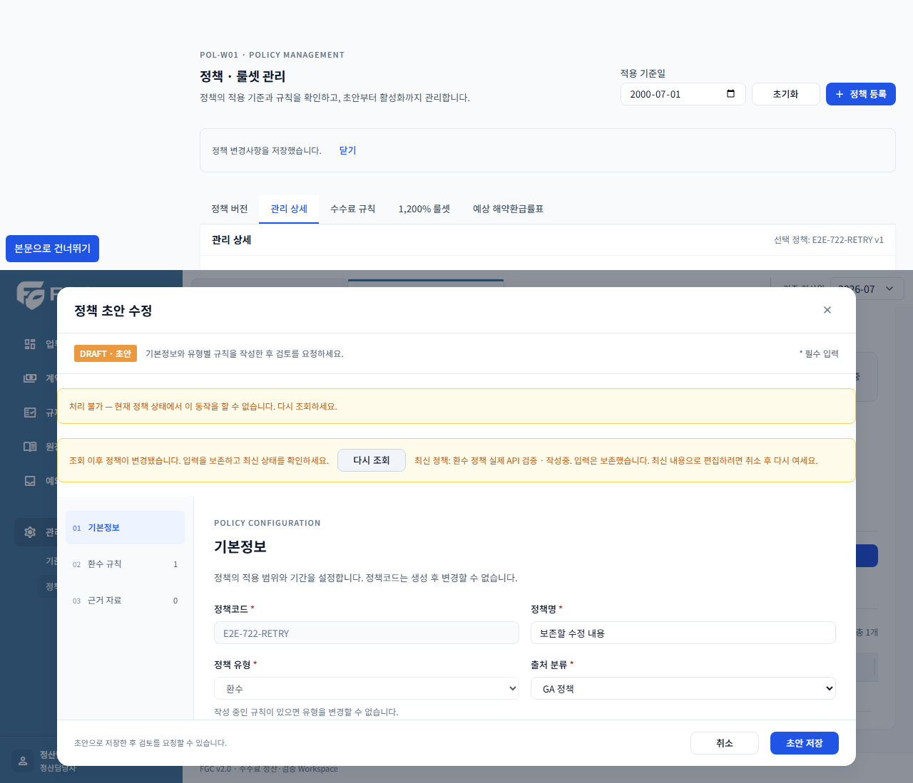
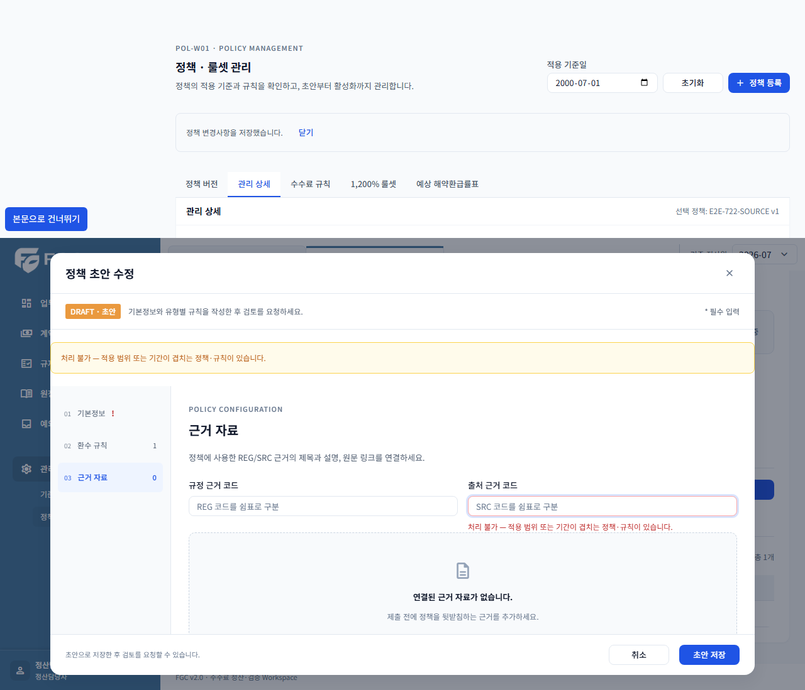

# #722 POL-W01 재오픈 후 구현·검증 기록

- 검증일: 2026-10-30 (Asia/Seoul)
- 브랜치: `codex/722-policy-completion`
- 기준 develop: `224d4374` (#766 D-02 결정 포함)
- 대상: IF-API-79·80·81·75, IF-API-10, CT-P01·CT-P02
- 환경: 로컬 실제 Spring Boot HTTP 서버 + PostgreSQL 17 일회성 DB + Chromium. 공유 개발계/운영 DB는 사용하거나 초기화하지 않았다.

## 구현

환수 정책의 D-02 차단을 제거하고 `PAID_ATTRIBUTED_AMOUNT` 기준의 초안 등록·수정·제출·타 사용자 승인·활성화·새 버전 복제를 연결했다. 환수율은 소수 6자리 문자열을 보존하며 0%도 유효한 입력이다. 회사 약정 환수율을 직접 입력하고 데모 환수율을 기본값으로 넣지 않는다.

형식·월 범위·환수율·정책 유형·미지원 조건식을 검증한다. 동일 대상 구간과 DB 저장 키 중복은 422와 해당 행 필드로 반환한다. 제출에는 규칙과 승인된 근거가 필요하다. 승인·활성화 충돌과 승계 범위 누락도 차단한다. 복제는 새 규칙 ID를 발급하며 승인본을 수정하지 않는다.

409에서는 입력과 기존 동시성 토큰을 보존한 채 최신 정책을 조회한다. 최신 토큰으로 자동 치환하여 오래된 입력을 덮어쓰지 않는다. 제출에서 누락 필드를 받으면 초안 편집의 해당 필드로 이동한다. 저장 성공 후에는 이전 오류를 초기화한다.

## 완료 기준별 증거

| 이슈 완료 기준 | 확인 방법 |
| --- | --- |
| 1. 실제 API 필드·버튼·권한·이동 + 캡처 | 실제 서버 E2E의 환수 등록 → 정산담당자 제출 → GA 관리자 승인·활성화 → 새 버전 복제·수정. 원본과 복제본의 DB 환수율을 별도로 대조한다. |
| 2. 로딩·0건·null/0·401·403·409·422·서버 실패·재시도 | 실제 API 0%·nullable 대상 저장, 세션 무효화 후 로그인 복구, stale updatedAt의 409, 구간 중복 422. 0건·403·500 표시 시험은 응답 장애 주입으로 구분한다. 공통 null·로딩 표시는 기존 정책/참조 테스트도 대조한다. |
| 3. 중복 클릭·응답 유실·모달·필터·입력 보존 | 실제 요청을 보류해 저장·취소 잠금을 확인한다. 실제 서버가 커밋한 응답만 유실시킨 뒤 같은 키로 재시도하여 정책 1건을 확인한다. 이전 기준일의 늦은 응답을 보내도 현재 목록을 덮어쓰지 않는지 확인한다. 모달 닫기 취소·409/422 입력 보존·필터 초기화, 기존 미리보기의 선택·좁은 화면 회귀를 검증한다. 새 버전 선택 후 기존 기준일 유지도 확인한다. |
| 4. URL/ID·권한·1차 회귀 | `PolicyWorkflowIntegrationTest`의 HTTP 권한·자식 소유권·불변 승인본·멱등/동시성 회귀, `PolicyControllerTest`, 기존 정책 미리보기 및 정책/참조 테스트. |
| 5. CT-P01·CT-P02 | CT-P01은 실제 서버 작성→다른 사용자 승인→활성화. CT-P02는 실제 422 행 필드 포커스와 제출 근거 누락 후 근거 필드 이동. |

## 실행

```powershell
.\gradlew.bat test --tests '*PolicyDraftValidatorTest' --tests '*PolicyWorkflowIntegrationTest' --tests '*PolicySuccessionValidatorTest' --tests '*PolicyWriteRepositoryIntegrationTest' bootJar
.\gradlew.bat test --tests '*PolicyControllerTest' --tests '*PolicySuccessionValidatorTest'
$env:FGC_EXPORT_OPENAPI='true'
.\gradlew.bat test --tests '*OpenApiFrontendIntegrationTest'
```

프론트에서 실행한다. 실제 서버와 미리보기의 출력 폴더를 분리한다. 서버 실행 중에는 같은 jar를 다시 빌드하지 않는다.

```powershell
npm exec -- vitest run src/features/policies src/features/reference/reference.test.tsx
npm run generate:api
npm run check:api
npm run lint
npm run build
npm run check:e2e
$env:FGC_E2E_DB_CONTAINER='fgc-e2e-722'
npm run test:e2e:demo -- policy-management.spec.ts --output test-results/policy-real
$env:FGC_E2E_ORIGIN='http://localhost:15174'
npm run test:e2e -- policy-management.spec.ts --output test-results/policy-preview
```

`fgc-e2e-722`는 기존 E2E 규격(`com.fgc.e2e=418`, DB/사용자 `fgc_e2e`, 포트 55418)의 일회성 컨테이너다. 테스트는 해당 라벨과 DB 이름을 확인한 뒤에만 스냅샷 복원을 허용한다.

## 결과와 캡처

- 프론트 정책·참조 테스트: **88개 통과**.
- 기존 정책 미리보기 E2E: **6개 통과**.
- 로컬 실제 API E2E: **5개 통과**. [기계 판독 결과](qa-722/real-api-results.json).
- 로딩·늦은 조회 응답·필터 초기화 보강 후 해당 실제 서버 시나리오 **1개 재검증 통과**.
- 최종 정책 작성 PostgreSQL·HTTP/검증/승계 테스트 **74개 통과**(40+23+11). 별도로 저장소 4개와 정책 컨트롤러 권한 회귀도 통과했다. [최종 서버 결과](qa-722/backend-results.json).
- 옵트인 실제 HTTP·JWT API 계약 검증: 프론트 계약 시험 **5개 통과**, OpenAPI 내보내기 성공. 기존에 누락된 비교/뉴스 등 다른 API의 명세 차이는 이번 변경에 포함하지 않고 `PolicyDraft.clawbackRules` 설명만 반영했다.
- 프론트 build·lint·check:api·check:e2e, Git 공백 검사 통과.

등록/승인/이력과 새 DRAFT:






실제 서버 오류와 입력 보존:





다음 세 화면은 표시 동작을 확인하기 위한 **응답 장애 주입**이며 실제 서버 장애로 기록하지 않는다: [0건](qa-722/06-query-200.png), [403](qa-722/06-query-403.png), [500](qa-722/06-query-500.png).

## 병합 후 개발계 확인

위 증거는 이 브랜치의 로컬 실제 서버 결과다. 공유 개발계 배포 SHA의 증거를 대신한다고 적지 않는다. 병합·배포 후 담당자는 배포 SHA와 같은 작성→타 사용자 승인 경로의 캡처를 #722에 연결하고 완료 기준을 체크한다. 이 PR에서는 이슈를 자동 종료하지 않는다.
