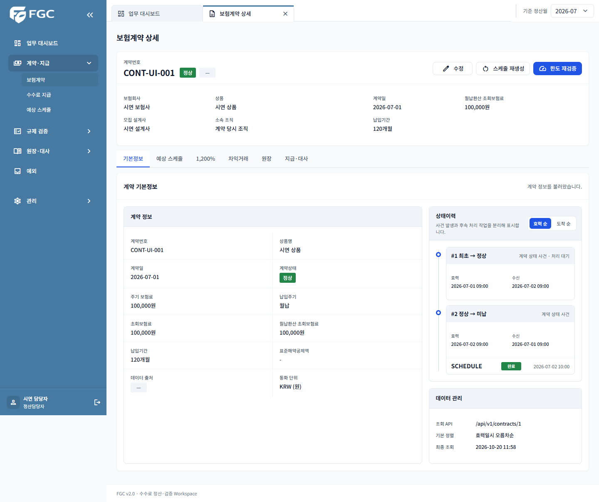
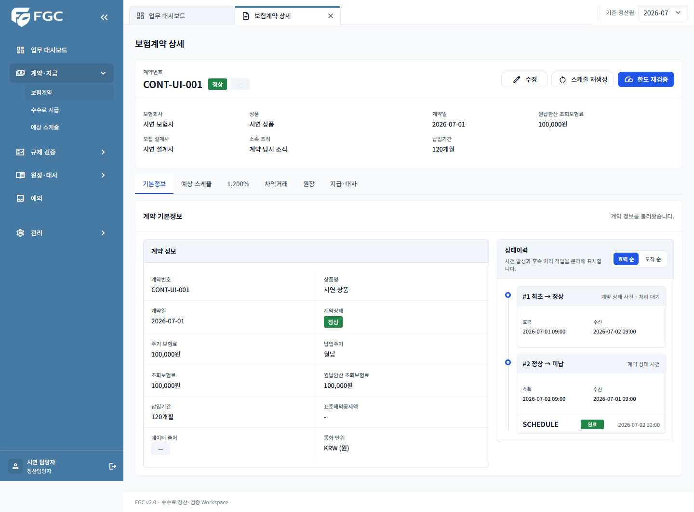
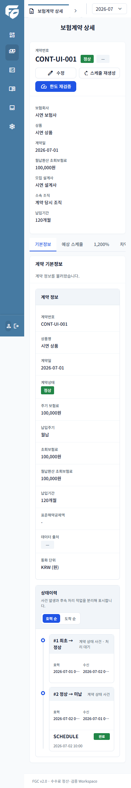

# 계약 상세 데이터 관리 카드 제거 검증

관련 이슈: #568

React 기본정보 탭과 지원 중인 Thymeleaf 상세에서 데이터 관리 카드 전체를 제거했다. 카드 전용 fetchedAt prop, DOM 갱신과 CSS를 정리했다. 상태이력의 공통 스타일은 유지하고, 중간 너비에서 상태이력을 두 열 중 한 열에만 배치하던 규칙을 제거했다.

## 검증 환경과 결과

- Node 22.22.2, 로컬 Vite, Chrome, 합성 API 픽스처. 운영·AWS 데이터는 사용하지 않았다.
- `npm test -- --run src/features/contract`: 기존 테스트 73개 통과. 정렬 전환·빈 상태·오류·조회와 캐시 흐름을 포함한다.
- `npm run lint`, `npm run build`: 통과.
- `npx playwright test e2e/contract-ui.spec.ts --workers=1`: 기존 브라우저 시나리오 4개 통과.
- 일회성 브라우저 점검: React 1440·1024·390px에서 카드 부재, 데이터 출처 유지, 양방향 정렬 전환, 후속 처리 표시, 가로 넘침 없음 확인. 1024px에서는 상태이력이 전체 너비를 사용하는지 확인.
- 레거시 점검: 실제 detail.html의 main과 contract-detail.js에 API 픽스처를 연결해 1440·1024·390px에서 계약 조회, 정렬 전환과 후속 처리 표시 확인. 서버의 Thymeleaf 렌더링 전체를 실행한 검증은 아니다.
- 변경 전후 화면은 동일한 합성 계약·상태 사건을 사용했다. 단순 JSX 부재를 복제하는 영구 테스트는 추가하지 않았다.

## 넓은 화면 변경 전

## 넓은 화면 변경 후

## 좁은 화면 변경 후

