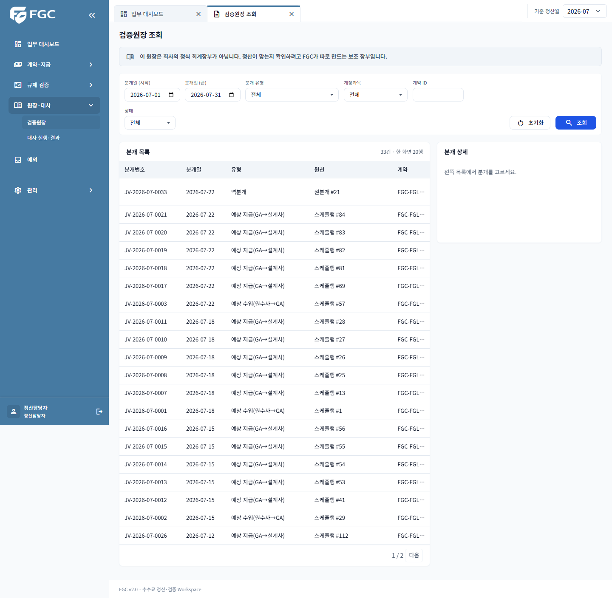
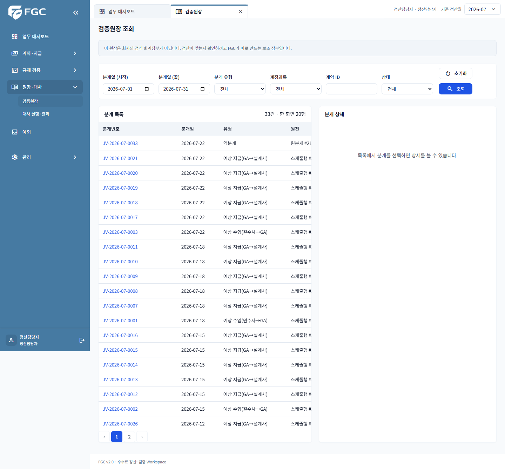
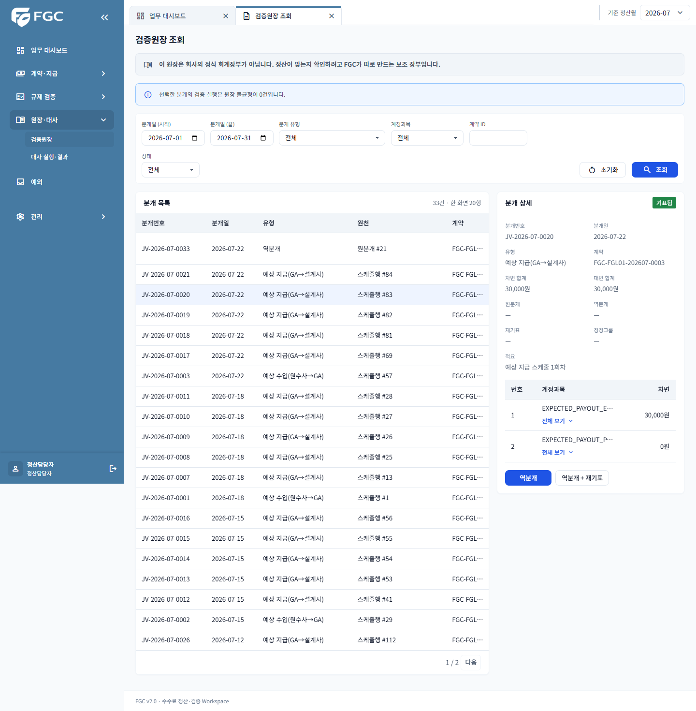
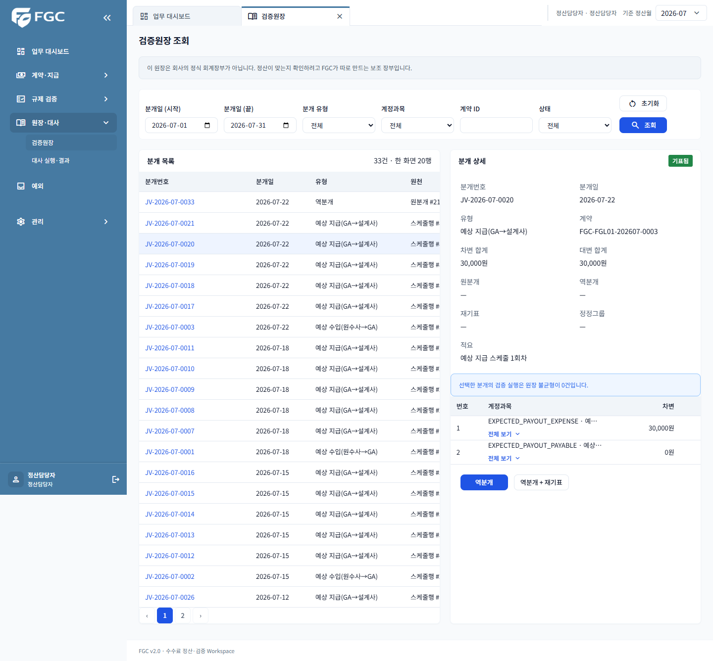

# LEDG-W01 전후 검증 (#413)

## 기준과 재현

- 기준: develop `80f21bee`, 기존 `/journals`, React `/app/journals`.
- PostgreSQL 17 전용 QA DB에 Flyway migration + demo를 적용하고, 기존 API로 2026-07 MONTHLY 검증을 생성·실행해 COMPLETED/8까지 진행했다. 최초 원장 32건 생성.
- 같은 계정·검색조건으로 1페이지 20행의 분개번호/순서 및 선택한 상세 JSON 전체가 일치함을 Playwright로 확인했다.
- 최종 스크린샷은 반복 QA 역분개 후 33건 상태에서 생성했다. 선택한 원장 #20의 차변·대변은 각 30,000원. 이후 역분개 #34 생성과 원분개 REVERSED 갱신까지 검증했다. 개발/운영 DB는 사용하지 않았다.
- `e2e/ledger.spec.ts`: fixture 흐름은 CI에서 실행. 실서버 케이스는 `FGC_LEDGER_QA_LOGIN_ID`, `FGC_LEDGER_QA_PASSWORD`, `FGC_LEDGER_QA_WRITE=true`가 모두 있을 때만 실행한다. 쓰기를 수행하므로 반드시 폐기 가능한 격리 DB를 사용한다. 인증정보는 파일에 저장하지 않는다.
- 명령: `npm run test:e2e -- ledger.spec.ts --workers=1`. 브라우저 설치가 없으면 `FGC_BROWSER_EXECUTABLE` 지정.

## 의도한 차이 / 유지 사항

| 항목 | 처리 |
| --- | --- |
| 검색 | `searched=true` 때만 목록 API 호출. `selected` 상세는 검색 여부와 독립적으로 조회. 조건·page·selected를 URL에 유지 |
| 계정과목 | #414의 `/api/v1/journals/accounts`와 Query 옵션을 재사용. 신규 API 없음 |
| `imbalanceOnly=true` | 목록 API는 지원하지 않고 불균형 API는 validationRunId 필수다. 월 전체 불균형을 임의 계산하지 않으며 미지원 안내를 표시. 상세 선택 후 검증 실행별 기존 배너를 제공 |
| 정정 요청 이동 | 응답 `/exceptions?selected=ID`를 검증 후 React Router로 이동하며 공통 정산월 유지. 실제 역분개+재기표 입력은 #414 예외함에서 처리 |
| 역분개 후 | 전체 새로고침 대신 journals 캐시 무효화로 목록·상세·불균형을 갱신. 원분개 선택 유지 |
| 표시/접근성 | 공통 금액·날짜·배지·모달 재사용. 행 선택은 키보드 버튼. 긴 분개번호는 전체 표시해 버튼 안에 disclosure를 중첩하지 않음 |
| 권한 | 서버 canReverseJournal 사용. COMPLIANCE 비활성, 미기표/역분개 원장/이미 역분개됨은 처리 불가. 서버가 최종 판정 |
| 오류 | code 기준, 서버 message 유지. COMMON-500은 requestId만 표시 |

## 스크린샷

## 테스트 이관

- `JournalViewControllerTest`: 초기 조회 대기·검색·selected → `ledger.test.tsx`.
- `PublishingTemplateStructureTest` 원장 부분 → `ledger.test.tsx`와 공통 컴포넌트 테스트, Playwright 전후 스크린샷.
- 기존 Thymeleaf/JS/뷰 컨트롤러/구조 테스트는 삭제하지 않았다(#419).
- #418: fixture 및 실서버의 조회→선택→역분개 시연 경로를 전달. 사람 리뷰 2인 승인은 별도 완료 조건이다.
