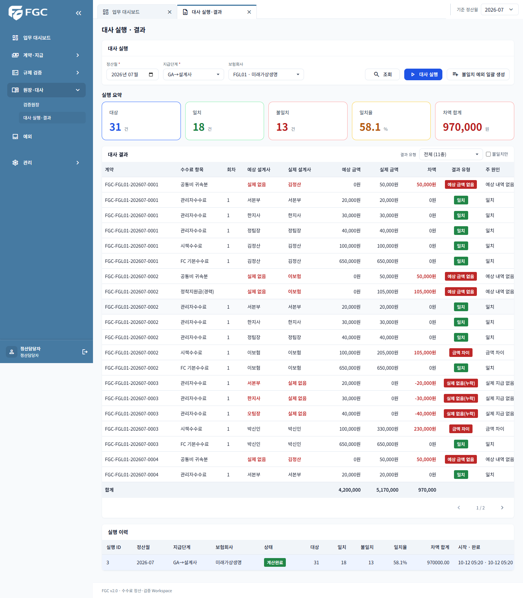
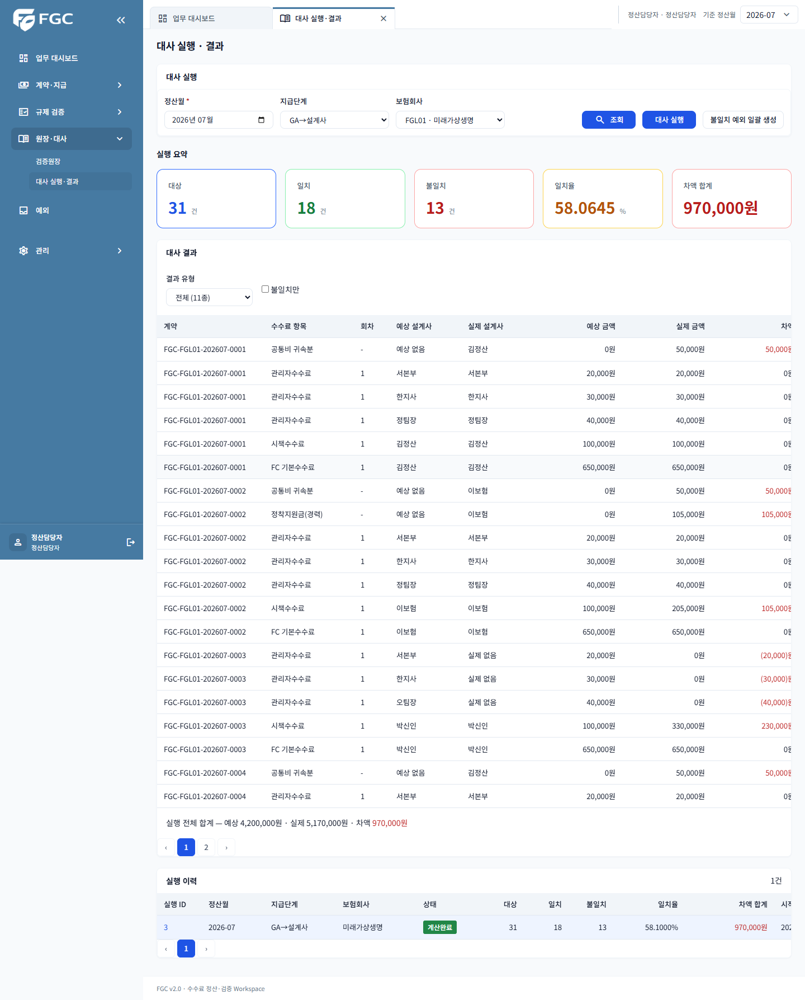
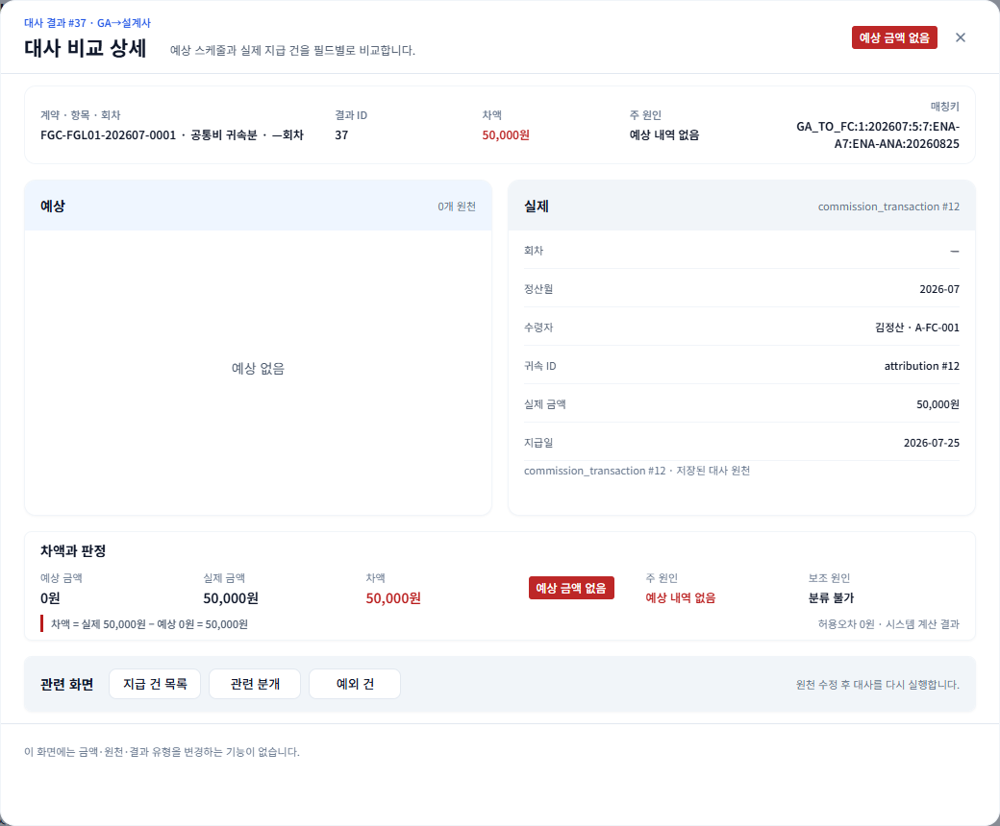
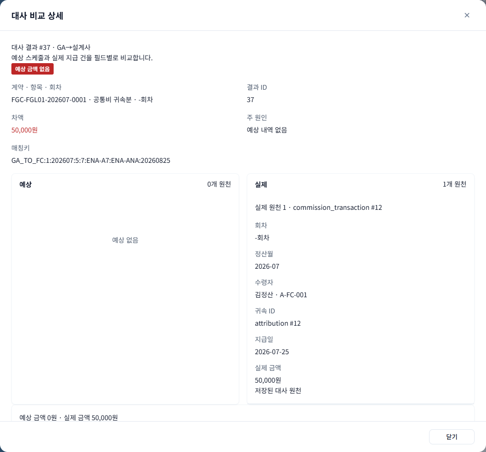

# #416 대사 실행·결과 / 비교 상세 React 전환 검증

## 범위와 기준

- RECO-W01 `/app/reconciliations`, RECO-W02 `resultId` 비교 모달.
- develop `80f21bee` 기반. #464·#453·#452의 도메인 폴더, 지연 로딩, 공통 UI/API, 생성 스키마 alias, 테스트·PR 구성에 맞췄다.
- #402·#403·#404 및 Reconciliation JPA #398이 병합되어 독립 진행 가능. #413 PR을 선행 병합할 필요는 없다.
- 기존 Thymeleaf와 JS, 백엔드/API 계약, DB/Flyway는 수정하지 않는다. 레거시 제거는 #419에서 진행한다.

## 구현·동작

- 정산월·지급단계·보험회사 조회, 실행 이력 20건 페이지, 결과 유형 11종·독립 결과 페이지.
- URL의 `insurer`를 API `insurerId`에 매핑한다. `runId`, `runMonth`, `resultId`, `resultPage`로 선택 상태를 보존한다.
- 최신 완료 검증 실행을 조회해 기존 생성 API를 호출한다. 생성 후 새 실행을 선택하고 CREATED/RUNNING 이력·결과를 2초 간격으로 갱신하며 완료 시 최종 결과를 다시 조회한다.
- 서버의 `canProcess`로 실행·일괄 예외 쓰기를 제한한다. GA_ADMIN·COMPLIANCE는 읽기 전용이다.
- 일괄 예외의 생성·중복 건수를 표시하고 예외함으로 이동한다. 기존 예외 API 날짜 계약에 맞게 `validationMonth=YYYY-MM-01`과 `status=ALL`을 전달한다.
- 비교 상세의 모든 EXPECTED/ACTUAL/BOTH 원천, 예상/실제 설계사, 금액·요율·날짜, 원인, 관련 화면 링크를 표시한다. 원천 부재를 명시하고 서버 계산값을 편집하지 않는다.
- COMMON-500은 요청 ID만 노출하며 다른 오류는 코드와 원문 메시지를 유지한다.

## 의도적인 표시 차이와 제약

- `onlyMismatch=true`는 레거시와 마찬가지로 **현재 서버 페이지**에서 MATCHED를 숨긴다. 서버 전체 불일치 필터 API는 없으므로 페이지 수를 임의로 줄이지 않고 안내한다.
- 합계는 화면에 남은 행의 재합산 대신 서버 `summary`의 **실행 전체 합계**를 표시한다. 결과 유형·불일치 표시 필터와 혼동하지 않도록 명시했다.
- 공통 금액 포맷(원·쉼표·음수 괄호)과 소수 4자리 요율 포맷을 사용한다. KPI 일치율은 서버 건수에서 계산하며 이력 일치율은 서버 `matchRatePct`를 그대로 포맷한다. 예: 18/31의 KPI 58.0645%, 서버가 1자리 반올림한 이력 58.1000%. 계산·정산 규칙은 변경하지 않았다.
- 공통 보험회사 옵션을 재사용하여 모든 페이지를 읽는다. 비활성 회사도 과거 이력 조회 조건으로 선택할 수 있지만 신규 실행은 막는다.
- 관련 지급·분개·예외 링크는 레거시의 목록 이동 의미를 유지하며 월만 보존한다. 미병합 화면은 해당 화면 PR 또는 #419 이후 사용 가능하다.
- 개별 실행 조회 API가 없어 현재 이력 페이지의 상태로 폴링한다. 페이지 밖 실행 ID 딥링크의 상태 확인은 이력 조회 범위에 의존한다.

## 자동·실서버 검증

- 도메인 Vitest 18건: 기존 16개 시나리오에 비활성 회사 조회/신규 실행 차단 및 null/0 회차 표시 회귀를 추가했다.
- 전체 Vitest 221건 통과 / opt-in 4건 제외.
- 전체 Playwright 24건 통과 / 실서버 opt-in 1건 제외. 별도 실서버 포함 최초 실행은 2건 통과. 후속 비활성 회사·null 회차 브라우저 회귀 2건도 포함한다.
- 백엔드 회귀 55건: ReconciliationRunController 17, ReconciliationView 6, CapPublishing 2, Publishing 30. 이슈에 적힌 View 7건과 현재 소스의 6건은 다르며 실제 존재하는 테스트를 기준으로 검증했다.
- lint, TypeScript/Vite build, API 스키마 검사를 수행했다.
- 전체 fixture Playwright는 백엔드를 끈 상태에서 실행했다. 실서버와 함께 실행하면 기존 auth fixture가 모킹하지 않은 dashboard 요청의 401로 로그아웃 테스트가 실패했다. 서버를 정지하고 전체를 재실행해 분리 검증했으며, 실서버 대사 시나리오는 별도로 검증했다. 공통 auth 코드는 이 PR에서 변경하지 않았다.
- 격리 PostgreSQL 데모 DB에서 2026-07 월 통합검증 후 GA→설계사/보험회사 1의 대사 실행 #3을 사용했다. 운영 DB에는 연결하지 않았다.
- Thymeleaf/React 이력 순서·ID, 결과 페이지 JSON과 비교 상세 JSON이 일치했다. 대상 31 / 일치 18 / 불일치 13, 예상 4,200,000원 / 실제 5,170,000원 / 차액 970,000원.
- 결과 #37: 예상 부재, 실제 50,000원, 원천 transaction #12 / attribution #12가 동일하다.
- 일괄 예외 재요청과 실제 예외함 조회 HTTP 200·내용·행 수, 미실행 회사 조합의 생성·완료·자동 선택, 재실행 FGC-RECO-002를 확인했다. 날짜 계약 회귀를 막도록 링크 URL과 실제 응답을 둘 다 검증한다.

## 재현 (#418 인계)

### #419 레거시 검사 인계

현재 `ReconciliationViewControllerTest` 6건은 삭제하지 않는다. `listRendersHistoryFromServer` / `listRendersEmptyStateWhenNoHistory` / `listSilentlyNormalizesInvalidStage`는 React 이력 조회·조건 정규화·빈 결과 및 Playwright 이력 대조로, `listEnablesActionButtonsForSettlement` / `listDisablesActionButtonsForCompliance`는 생성·권한 Vitest로, `unauthenticatedUserCannotViewList`는 공통 auth 보호 딥링크 Playwright로 대체한다. `CapPublishingControllerTest`와 `PublishingControllerTest`의 Thymeleaf 구조 검사는 공존기 동안 유지하며 해당 화면 전환의 대체 검증과 함께 #419에서 정리한다.

### 실행 절차

1. Node 22에서 `npm ci`, `npm run test -- --maxWorkers=2`, `npm run lint`, `npm run build`, `npm run check:api` 실행.
2. Chrome/Playwright 환경에서 `npx playwright test --workers=2` 실행.
3. 실서버 비교는 **별도 데모 QA DB**로 백엔드 8081과 Vite를 실행한다. 2026-07 완료 월 통합검증, 보험회사 1 GA_TO_FC 대사와 불일치 결과, 활성 회사의 미실행 GA_TO_FC 조합이 필요하다.
4. 환경변수 `FGC_RECO_QA_LOGIN_ID`, `FGC_RECO_QA_PASSWORD`, `FGC_RECO_QA_WRITE=true`를 지정하고 `npx playwright test e2e/reconciliation.spec.ts` 실행. 필요하면 `FGC_BROWSER_EXECUTABLE`을 지정한다. 인증정보는 저장/커밋하지 않는다.
5. 실서버 테스트는 일괄 예외·새 대사 실행을 실제로 생성하므로 운영 DB에서 실행하지 않는다. 반복 시 미실행 조합이 소진되면 새 격리 DB가 필요하다.

## 전후 화면 (동일 데모 데이터)

### 실행·결과

### 비교 상세

모달 본문은 스크롤 가능하다. 캡처에 없는 아래쪽 분류·산식·관련 링크도 브라우저 테스트로 확인했다.
