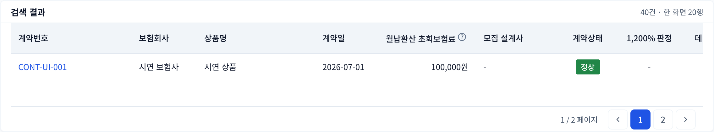

# #549 페이지네이션 비활성 버튼 표시

보험계약 React 화면(`/app/contracts`)을 Chromium에서 테스트 API 응답으로 검증했습니다. 실제 고객 데이터는 사용하지 않았습니다.

## 수정 전후

두 페이지 중 첫 페이지입니다. 화살표는 5페이지 그룹 이동이므로 이 경우 양쪽 모두 비활성 상태입니다.

### 수정 전

### 수정 후

## 브라우저 검증

- 수정 전: 비활성 버튼의 opacity=1, pointer-events=auto. hover 시 배경과 테두리가 강조됨.
- 수정 후: 비활성 버튼의 opacity=0.4, pointer-events=none. hover 전후 배경과 테두리가 동일함.
- 비활성 화살표 클릭 시 추가 조회 없음.
- 숫자 2 클릭 시 2페이지 이동.
- 총 12페이지의 6페이지에서 활성 버튼의 opacity=1 및 hover 강조 유지.
- 다음 5페이지 클릭: 6 → 11, 이전 5페이지 클릭: 11 → 10.

페이지 이동 규칙과 API는 변경하지 않았습니다.
