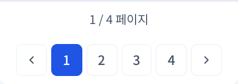

# #555 예외 목록 페이지네이션 통일

> 후속 통합: 이 문서는 초기 로컬 작업 기록입니다. 최종 공통 표시 조건·배치와 푸시 상태는 [#559 검증 기록](../559/README.md)을 기준으로 합니다. #550·#554는 현재 병합되어 있습니다.
상위 추적 이슈: #552. 현재 작업 범위는 이슈 생성·로컬 코드 수정·검증이며 PR은 생성하지 않았습니다.

## 구현

예외 목록에서 기존 공통 Pagination의 legacy 모드를 사용합니다.

- 처음·마지막 텍스트 버튼 제거
- 화살표와 숫자 최대 5개로 표시
- 기존 5페이지 묶음 이동 유지: 다음 4→6, 이전 6→5
- 숫자를 선택하면 해당 페이지로 직접 이동
- 현재/전체 페이지·검색조건·정산월 유지
- 페이지 변경 시 기존 동작대로 선택 항목 초기화
- 예외 목록 전용 접근성 이름 추가

## 선행 작업과 중복 방지

- #550: 공통 CSS의 비활성 표시 및 현재 페이지 hover 색상 수정
- #554: 수수료 지급 화면 동일 UI, legacy 화살표 title 안내 추가

두 PR이 아직 미병합이므로 해당 공통 코드를 이 브랜치에 중복 작성하지 않았습니다. 일반 수정 후 스크린샷은 이 브랜치 자체 화면이며, 비활성 흐린 표시는 #550 병합 후 적용됩니다. 화살표 title 안내는 #554 병합 후 적용됩니다.

## 검증 결과

- 공통 Pagination·예외 목록 대상 테스트: 32 passed
- 전체 프런트엔드 테스트: 438 passed / 4 skipped (기존 조건부 skip)
- ESLint·TypeScript·Vite 운영 빌드·git diff --check 통과
- Chromium에서 4→6, 6→5, 6→11, 숫자 선택 및 첫·마지막 묶음 경계 확인
- 총 4페이지면 양쪽 묶음 화살표는 비활성이고 숫자 1~4는 선택 가능
- contractNo·validationMonth·month·type·status 유지, selected 초기화 확인
- 375px에서 버튼이 뷰포트를 넘지 않음
- #550 브랜치의 실제 CSS를 브라우저에 추가 적용해 disabled opacity=0.4 및 현재 페이지 hover 전후 색상 유지 확인. 브랜치 소스에는 이 CSS를 복사하지 않음

테스트 API 응답을 사용했으며 실제 고객 데이터·DB는 사용하지 않았습니다.

## 스크린샷

### 수정 전 (이 브랜치의 수정 전 화면)

### 수정 후 (이 브랜치 자체)

### 375px 화면 (이 브랜치 자체)

### #550 공통 CSS를 함께 적용한 통합 확인

