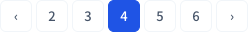
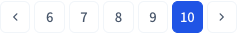
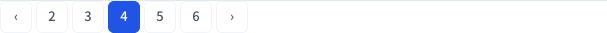
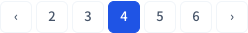
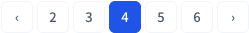

# #557 숫자 목록형 페이지네이션 통일

상위 이슈: #552. 별도 브랜치 `fix/557-group-pagination`에서 수정·검증했습니다. 사용자 요청에 따라 커밋·푸시하며, PR은 명시적인 요청 전까지 생성하지 않습니다.

## 구현

기준정보(조직·보험회사·상품·설계사), 예상 스케줄, 1,200% 한도 검증, 검증원장, 감사로그, 월 통합검증, 차익거래 검증에서 공통 Pagination의 legacy 모드를 사용합니다.

- 4페이지: `1 2 3 [4] 5`, 이전 묶음 없음·다음은 6페이지
- 6페이지: `[6] 7 8 9 10`, 이전은 5페이지·다음은 11페이지
- 마지막 묶음에서는 다음 비활성, 숫자 클릭은 해당 페이지 이동
- 기존 검색조건·정산월·선택 초기화 규칙 유지
- 차익거래의 전체 숫자 표시는 최대 5개로 제한
- 각 화면 navigation에 목록 이름 부여
- 월 통합검증의 중첩 nav를 footer + nav로 정리

공통 CSS는 병합된 #550을 그대로 사용합니다. 화살표 title 안내는 #554에서 관리하므로 중복 수정하지 않았습니다. 보험계약·수수료 지급(#554)·예외(#555)·대사(#556)의 별도 작업을 건드리지 않았습니다. 대사 두 영역은 합의한 `‹ 현재/전체 ›` 한 페이지 이동 방식을 유지합니다.

## 검증

- 기존 대상 단위 검사: 57 passed
- 전체 프런트엔드: 437 passed / 4 skipped (기존 조건부 skip)
- Playwright 10개 화면 상태: 10 passed
- 각 화면에서 4→6, 6→5, 숫자 3, 6→11, 11→10 및 첫·마지막 묶음 확인
- URL 검색조건·정산월 유지 및 API page 변경 확인
- 375px 화면에서 페이지 이동부가 뷰포트를 넘지 않음
- ESLint·E2E TypeScript·앱 TypeScript·운영 빌드·git diff --check 통과
- React 품질 점검: 공통 컴포넌트 재사용, native disabled·aria-current·접근성 이름 유지, 새 데이터 조회·effect 없음

브라우저 검사: `frontend`에서 `npm run test:e2e -- e2e/pagination-groups.spec.ts`.
테스트 API 응답을 사용했으며 실제 DB 연동은 검증하지 않았습니다. API·계산·DB 변경은 없습니다.

## 스크린샷

데스크톱 전후는 총 12페이지 중 4페이지, 모바일은 총 12페이지 중 10페이지입니다. 이전 화면은 수정 전 소스를 잠시 복원하여 같은 fixture로 촬영하고 작업 소스를 즉시 복구했습니다.

### 기준정보 조직

수정 전:

수정 후:

375px:

### 기준정보 보험회사

수정 전:

수정 후:

375px:

### 기준정보 상품

수정 전:

수정 후:

375px:

### 기준정보 설계사

수정 전:

수정 후:

375px:

### 예상 스케줄

수정 전:

수정 후:

375px:

### 1,200% 한도 검증

수정 전:

수정 후:

375px:

### 검증원장

수정 전:

수정 후:

375px:

### 감사로그

수정 전:

수정 후:

375px:

### 월 통합검증

수정 전:

수정 후:

375px:

### 차익거래 검증

수정 전:

수정 후:

375px:

