# #559 페이지네이션 표시 조건·페이지 정보·하단 배치 통일

상위 이슈 #552. 기존 로컬 #555·#556 작업과 이번 추가 정리를 `fix/559-pagination-footer`에 통합하여 커밋·푸시합니다. 원본 작업 폴더는 보존했습니다. PR은 생성하지 않습니다.

## 브랜치 기준

#558의 브랜치 `fix/557-group-pagination`을 기반으로 합니다. 공통 CSS는 #550, 기존 묶음 이동과 화살표 안내는 #554·#558의 코드를 재사용합니다. 이후 PR 생성 시 #558 병합 상태를 확인하고 최신 develop을 반영합니다.

## 구현

- 숫자 목록 10개 영역(기준정보 4탭 포함 13개 화면 상태)에 ListPagination 적용
- 0·1페이지에서 이동 버튼 및 불필요한 페이지 이동부 숨김
- 여러 페이지에서는 현재/전체 페이지와 최대 5개 숫자·묶음 이동 화살표 표시
- 하단 우측 정렬·여백·구분선과 좁은 화면 줄바꿈 통일
- 한도 검증의 행 수 선택기는 0·1페이지에도 유지하며 실제 변경 동작 보존
- 기존 필터·정산월과 각 화면 상세 선택 유지/초기화 규칙 보존
- #555: 예외 목록도 숫자 묶음 방식에 포함
- #556: 대사 결과·실행 이력은 별도 `‹ 현재/전체 ›` 한 페이지 이동. 두 페이지 상태 독립 유지

기존 공통 Pagination의 이동 로직은 변경하지 않았습니다. Thymeleaf 공통 CSS에도 추가 수정은 없습니다. 계약 화면의 실서버 비교 검사는 의도적으로 달라진 페이지네이션 배치를 픽셀 동등 비교에서 제외하고, 대신 0·1페이지 숨김·다중 페이지 정보·경계 조건을 검증하도록 바꿨습니다. 실서버 미설정으로 이번 실행에서는 해당 검사가 건너뛰어졌습니다.

## 검증

- 전체 Vitest: 443 passed / 4 skipped
- 전체 fixture Playwright: 67 passed / 5 skipped (기존 실서버 설정 필요 검사)
- 페이지네이션 대상 13개 화면 상태: 13 passed
- 4→6, 6→5, 숫자 직접 선택, 6→11, 11→10과 경계 확인
- 모든 숫자 목록에서 0·1페이지 UI 숨김, 현재/전체 표시 및 우측 여백 확인
- CAP의 0·1페이지에서 행 수 선택기 유지 및 size=50 요청 확인
- 375px에서 페이지 이동부 넘침 없음
- 대사 결과·이력 독립 다음/이전·필터 유지·숨김·비활성 hover 확인
- ESLint·E2E TypeScript·앱 TypeScript·운영 빌드·git diff --check 통과
- React 품질 점검: 공통 하단 UI 재사용, 네이티브 disabled·접근성 이름·aria-live 상태 안내, 업무 API·effect 추가 없음

테스트 API 응답을 사용했으며 실제 DB 연동은 검증하지 않았습니다. 데이터·계산·API 계약·DB 변경은 없습니다.

## 관련 기록

- [#555 초기 예외 목록 작업](../555/README.md)
- [#556 대사 결과·이력 작업 및 스크린샷](../556/README.md)
- [#557 숫자 목록 묶음 이동 작업](../557/README.md)

## 비교 스크린샷

총 12페이지 기준 데스크톱 4페이지, 모바일 10페이지입니다. 수정 전은 이전 원본 소스를 잠시 복원해 동일 fixture로 촬영한 이동 버튼 영역입니다. 수정 후는 페이지 정보를 포함한 전체 공통 footer입니다. 촬영 후 작업 코드를 즉시 복구했습니다.

### 보험계약

수정 전:

수정 후:

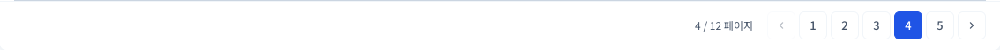

375px:

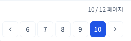

### 수수료 지급

수정 전:

수정 후:

375px:

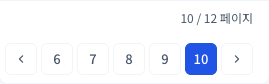

### 예외

수정 전:

수정 후:

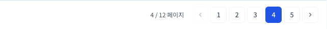

375px:

### 기준정보 조직

수정 전:

수정 후:

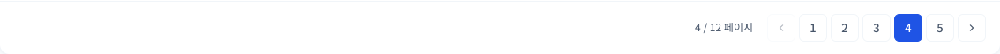

375px:

### 기준정보 보험회사

수정 전:

수정 후:

375px:

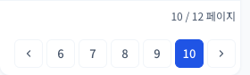

### 기준정보 상품

수정 전:

수정 후:

375px:

### 기준정보 설계사

수정 전:

수정 후:

375px:

### 예상 스케줄

수정 전:

수정 후:

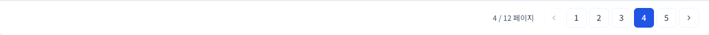

375px:

### 1,200% 한도 검증

수정 전:

수정 후:

375px:

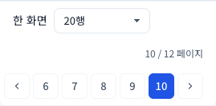

### 검증원장

수정 전:

수정 후:

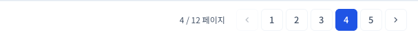

375px:

### 감사로그

수정 전:

수정 후:

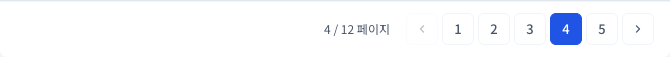

375px:

### 월 통합검증

수정 전:

수정 후:

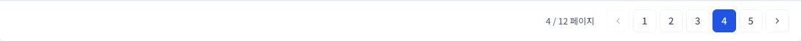

375px:

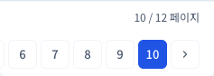

### 차익거래 검증

수정 전:

수정 후:

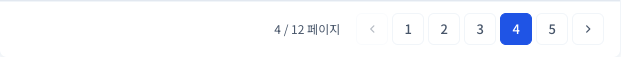

375px:

