# #562 React 화면 중복 바깥 여백 제거

상위 이슈 #552. 최신 develop(d8347dd7)에서 독립 분기했습니다.

## 변경

AppShell은 이미 `.page-content`로 Outlet을 감쌉니다. 업무 대시보드·예외함·월 통합검증 목록/상세에 중복된 같은 클래스를 제거했습니다. 상세의 로딩·오류·정상 상태를 모두 포함합니다. 화면별 grid와 카드 간격, 데이터 조회·버튼 동작은 유지합니다. 공통 CSS와 Thymeleaf는 변경하지 않습니다.

| 공통 바깥 여백 | 수정 전 | 수정 후 |
| --- | --- | --- |
| 데스크톱 좌우 | 48px | 24px |
| 모바일 좌우 | 32px | 16px |
| 상단 | 32px | 16px |
| 하단 padding 합계 | 64px | 32px |

대시보드 grid gap 12px, 예외·월 통합검증 gap 16px 유지. margin은 전후 0px입니다.

## 검증

- Chromium 1440px·375px에서 4개 화면의 실제 공통 padding·좌측/상단 위치 확인
- 상세 로딩·404 오류도 중복 여백 없이 표시
- [수정 전 실측](before-measurements.json), [수정 후 실측](after-measurements.json)
- 전체 Vitest: 438 passed / 4 skipped (기존 조건부 제외)
- 기존 예외 처리·월 통합검증 생성/실행/확정·AppShell E2E: 8 passed
- E2E 타입 검사·ESLint·앱 타입 검사·운영 빌드·git diff --check 통과
- React 점검: 화면 루트 클래스만 변경, hooks/effect·업무 로직·접근성 의미 변경 없음

API 응답 fixture를 사용했습니다. 실제 DB 연동 검증은 수행하지 않았습니다. 아래 이미지는 화면 바깥 여백을 비교하기 위한 본문 상단 650px 영역입니다. 모바일 뷰포트는 375px이며 사이드바를 제외한 본문을 촬영했습니다.

## 업무 대시보드

| 화면 | 수정 전 | 수정 후 |
| --- | --- | --- |
| 데스크톱 | 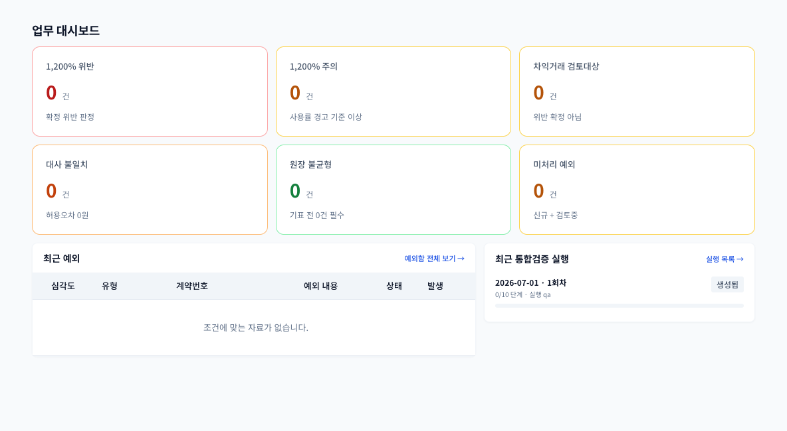 | 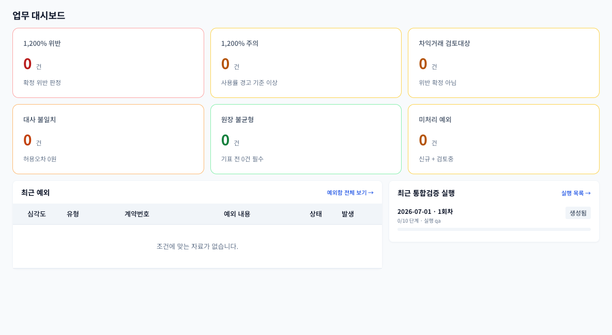 |
| 모바일 | 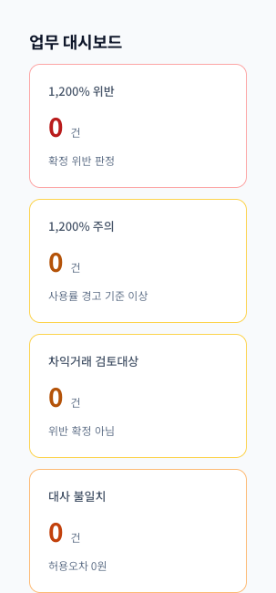 | 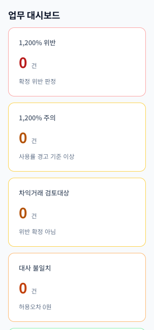 |

## 예외함

| 화면 | 수정 전 | 수정 후 |
| --- | --- | --- |
| 데스크톱 | 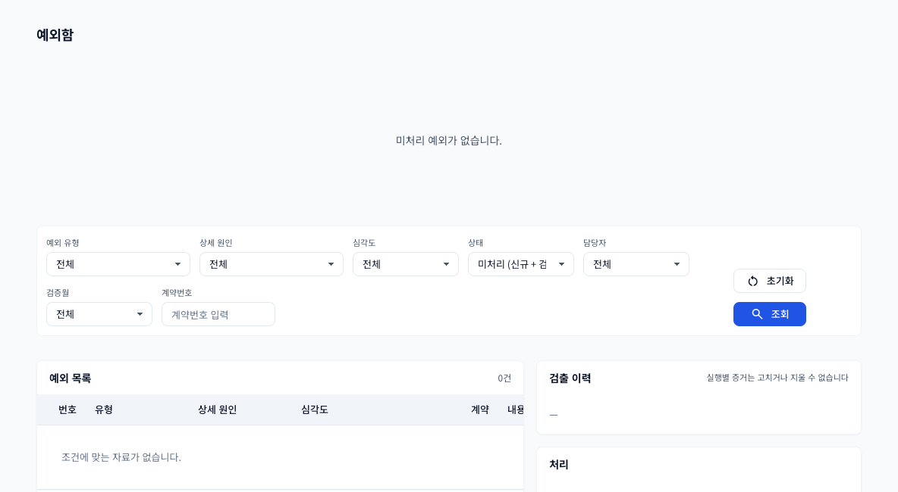 | 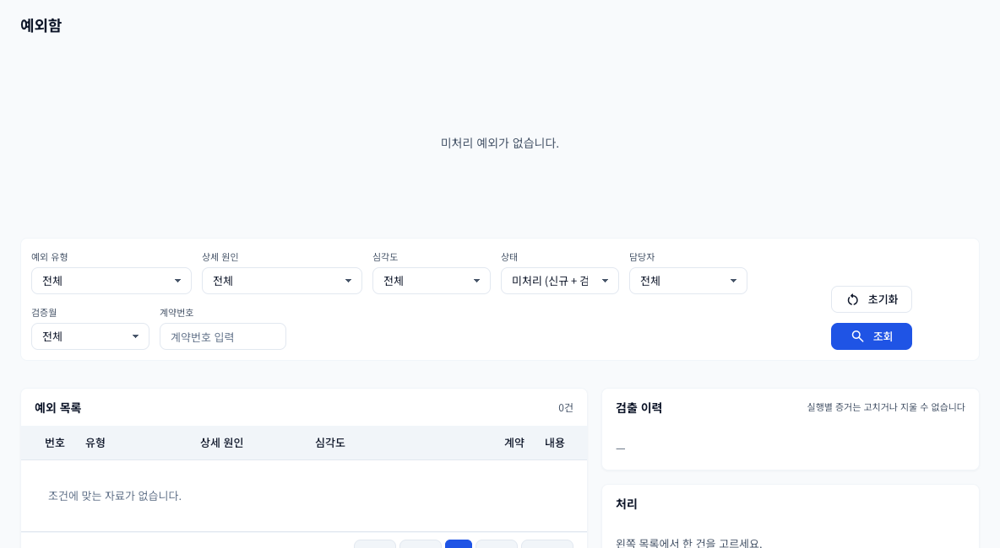 |
| 모바일 | 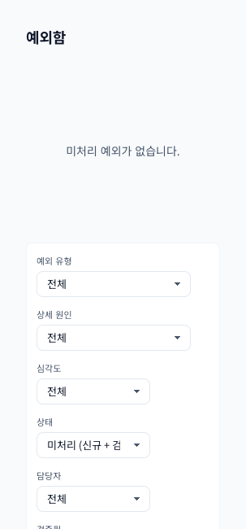 | 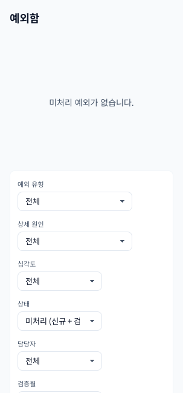 |

## 월 통합검증 목록

| 화면 | 수정 전 | 수정 후 |
| --- | --- | --- |
| 데스크톱 | 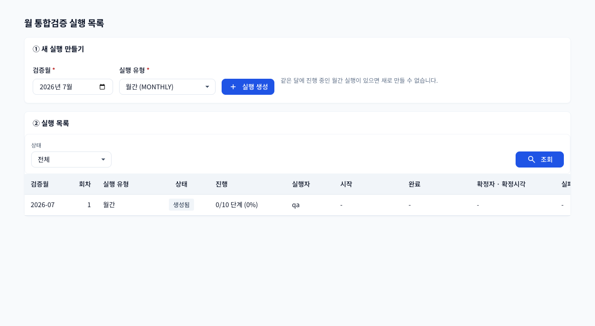 | 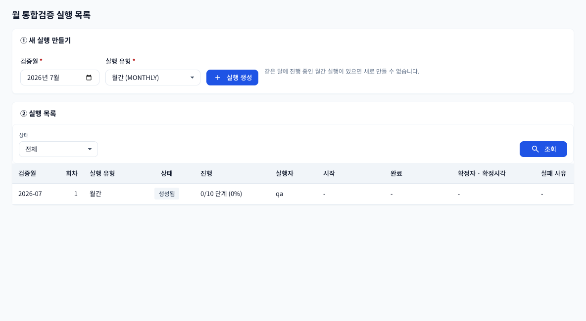 |
| 모바일 | 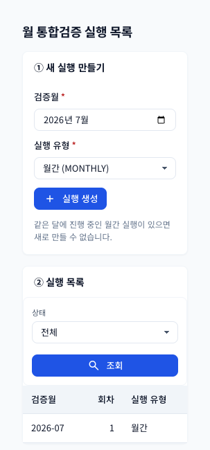 | 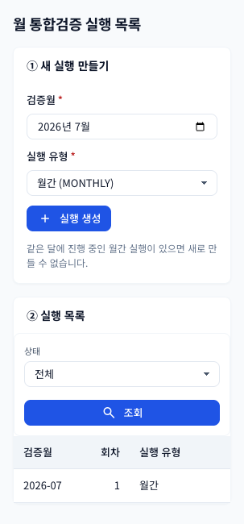 |

## 월 통합검증 상세

| 화면 | 수정 전 | 수정 후 |
| --- | --- | --- |
| 데스크톱 | 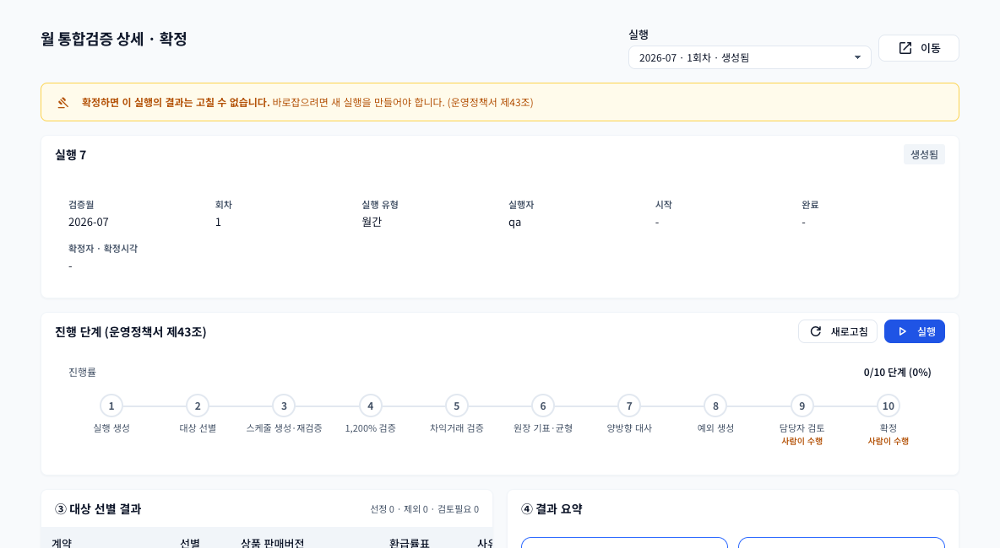 | 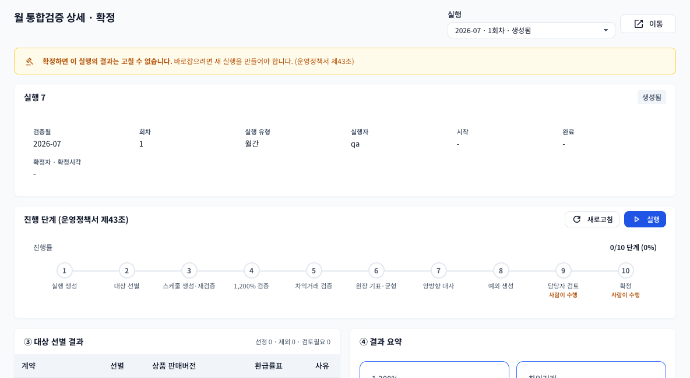 |
| 모바일 | 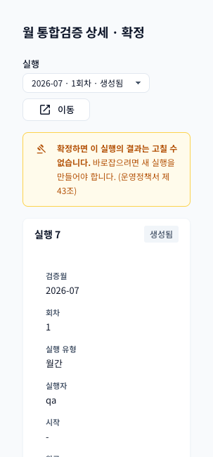 | 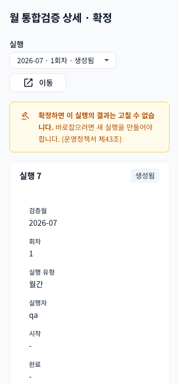 |

